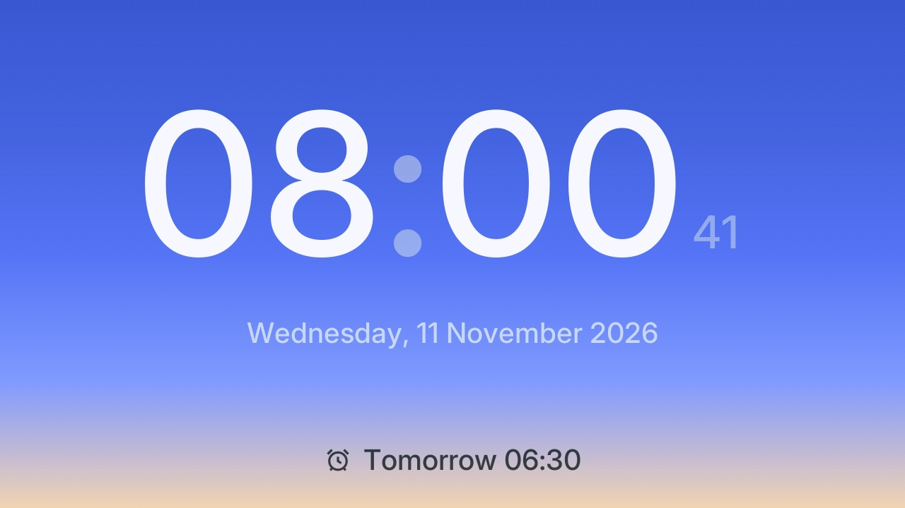
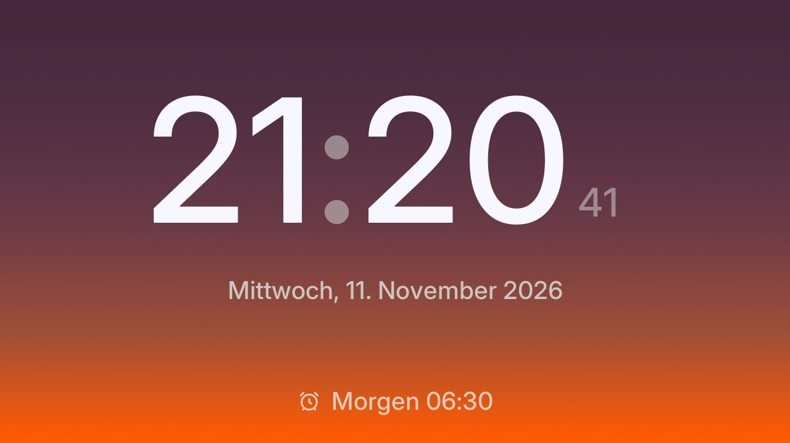
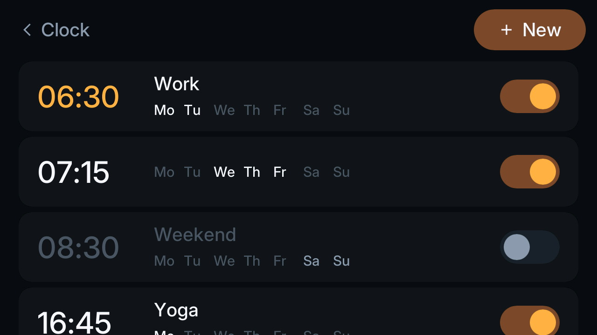
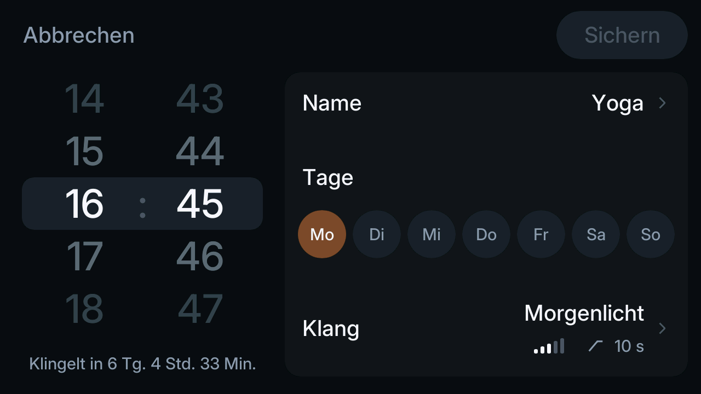
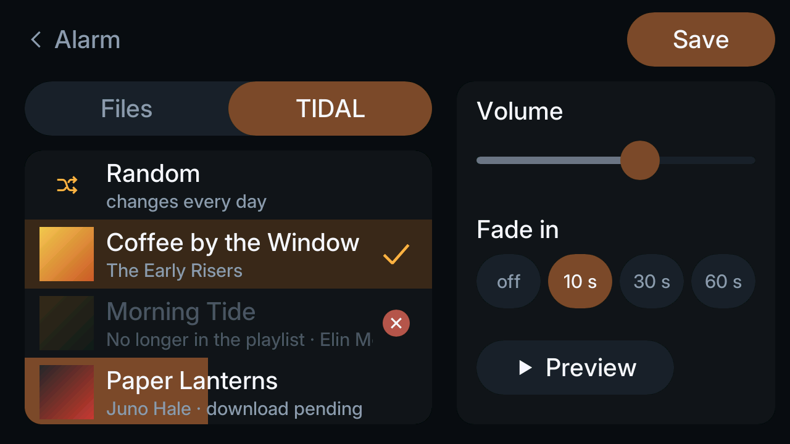
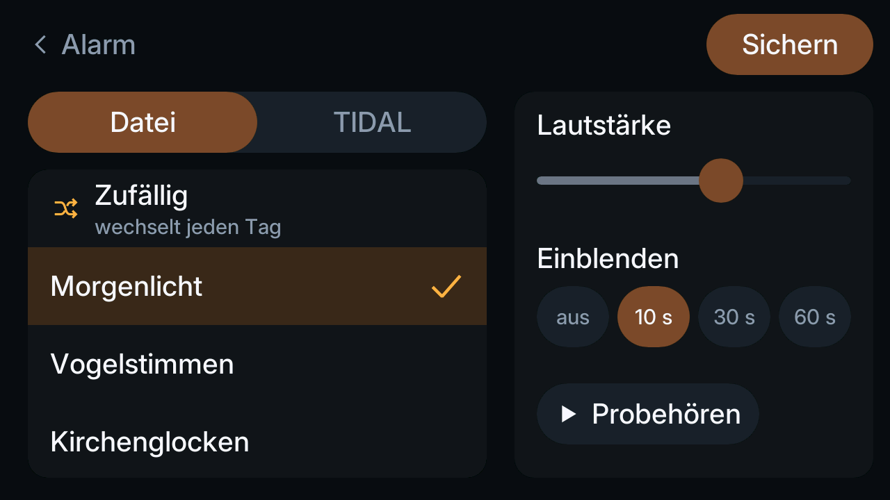
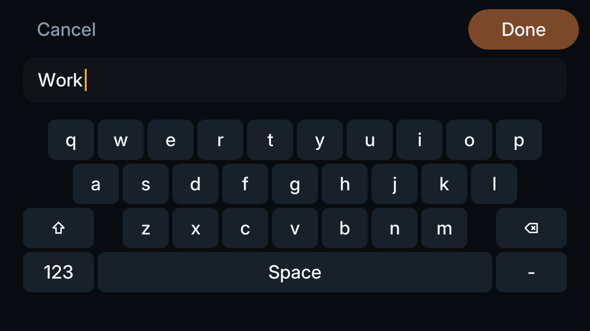

# Wakey

[](https://github.com/wackazong/wakey/actions/workflows/ci.yml)
[](#license)

A bedside alarm clock for the [M5Stack Tab5](https://docs.m5stack.com/en/core/Tab5): a 5" touch screen with a sky that follows the sun, alarms set by touch, and wake-up sounds from the microSD card, a TIDAL playlist, or sent from an iPhone or Mac by AirDrop. The firmware is written in Rust on ESP-IDF.

<p align="center">
  
  
</p>
<p align="center">
  
  
  
</p>

The screenshots are rendered from the firmware's own UI code by [`tools/ui-preview`](tools/ui-preview/src/main.rs), with the renderer the device uses. The screen speaks English or German.

**Contents:** [Features](#features) · [What you need](#what-you-need) · [Install](#install) · [Using the clock](#using-the-clock) · [Configuration](#configuration) · [If something does not work](#if-something-does-not-work) · [How it works](#how-it-works) · [Limitations](#limitations) · [License](#license)

## Features

- **Clock face** with large rolling digits, the date and the next alarm. The background sky follows the sun's elevation through the day: blue at noon, orange at sunset, dark purple at night.
- **Several alarms**, each with a time, weekdays, a name, a sound, a volume and a fade-in, set on the touch screen with time wheels that click like a mechanical dial.
- **Wake-up sounds** from the microSD card (WAV, AIFF, FLAC, MP3, AAC and ALAC in M4A), a different one each day if you like, or tracks from a **TIDAL playlist**, downloaded to the card in lossless quality so an alarm never depends on the network.
- **AirDrop:** send sound files from an iPhone or a Mac straight to the clock.
- **Speakers:** a USB speaker on the Tab5's USB-A port, or the built-in speaker when none is connected.
- **Kind to a bedroom:** the camera works as a light meter and dims the screen in a dark room; the display sleeps in the dark and wakes on touch, at daylight or when an alarm rings.
- **Network only when needed:** The Wi-Fi chip is on for a clock sync once a day and while TIDAL or AirDrop is in use, and off otherwise. The real-time clock keeps the time in between.
- **Smooth touch UI:** scrolling and swiping at the panel's 66 frames per second.

## What you need

- An [M5Stack Tab5](https://docs.m5stack.com/en/core/Tab5) with the ST7123 display (the only variant supported, see [Limitations](#limitations)).
- A microSD card, formatted as FAT.
- A USB-C cable to a computer, for flashing.
- Optional: a USB speaker for the USB-A port. It must be a USB Audio Class 1.0 speaker that takes 48 kHz, 16 bit, stereo; a Creative Pebble V3 is what Wakey is developed with.
- Optional: a 2.4 GHz Wi-Fi network (clock sync, TIDAL), and a TIDAL subscription with API credentials for the playlist.

Details on the board, pins and power: [docs/hardware.md](docs/hardware.md).

## Install

### 1. Flash the firmware

You need [rustup](https://rustup.rs), Git and Python 3, and two Cargo tools:

```sh
cargo install espflash ldproxy
```

Connect the Tab5 by USB-C, then:

```sh
git clone https://github.com/wackazong/wakey
cd wakey/firmware
cargo run --release --bin wakey     # build, flash, open the log
```

The pinned Rust toolchain installs itself. The first build downloads and compiles ESP-IDF, which takes about ten minutes; later builds are quick. If espflash does not find the board, name the port: `ESPFLASH_ARGS="--port /dev/…" cargo run --release --bin wakey`. Building and flashing in detail: [firmware/README.md](firmware/README.md).

### 2. Prepare the microSD card

1. Create a file `config.json` in the card's root with your Wi-Fi:

   ```json
   { "wifi": { "ssid": "MyNetwork", "password": "secret" } }
   ```

   Everything else has defaults, and the clock adds them to the file at its first start. Without Wi-Fi the clock works too; it then keeps the time of its real-time clock.
2. Create a folder `sounds/` and put sound files into it. The file name is what the clock shows (`_` becomes a space). Without any file, alarms ring with a built-in tone.
3. Insert the card and switch the clock on.

### 3. First start

The clock shows the time and syncs it over Wi-Fi within a minute. On this first start it also installs its own firmware on the Tab5's Wi-Fi chip (the ESP32-C6), in the background in about half a minute; nothing needs to be done by hand.

## Using the clock

| To … | Do this |
| --- | --- |
| open the alarms | Tap the alarm line at the bottom of the clock face. |
| add an alarm | Tap "+ New" in the alarm list. |
| change an alarm | Tap its row. Turn the wheels for the time, tap the weekdays, the name or the sound, then "Save". |
| switch an alarm on or off | Use the switch in its row. |
| delete an alarm | Swipe its row to the left. |
| choose a sound | On the alarm's page tap "Sound", then pick a file or a TIDAL track, set the volume and the fade-in. "Preview" plays it. |
| snooze | Tap anywhere on the screen while the alarm rings. |
| stop an alarm | Hold the button at the bottom of the screen for 1.5 seconds. |
| wake the display | Tap it. |

A settings page left alone goes back to the clock after a minute. The clock face shows a small symbol when no USB speaker is connected (alarms then ring on the built-in speaker) or when there is no network.

<p align="center">
  
  
</p>

### Sounds by AirDrop

1. On the clock, open an alarm, tap "Sound" and stay on the "Files" tab. After a few seconds the list's last row says "AirDrop ready for new sounds".
2. On the iPhone or Mac, share a sound file by AirDrop and choose "Wakey".
3. The file shows up in the list with a progress bar and can be picked as soon as it is complete.

The receiver is on only while this tab is open.

### Sounds from TIDAL

Two sets of credentials are involved. The first is an **API client**, which identifies the app to TIDAL: a `client_id` and a `client_secret`. Wakey ships none, so you add your own, and it must be allowed to use TIDAL's device login. The second is **your login**, which the clock gets from the QR code and stores in `config.json` by itself. Until the API client is there, the TIDAL tab says that it is missing and shows no QR code.

1. Add the API client to the `tidal` section of `config.json` on the card, and restart the clock:

   ```json
   "tidal": { "client_id": "…", "client_secret": "…", "playlist": "Wakey" }
   ```

   Create a playlist named "Wakey" in your TIDAL collection, or set `playlist` to another name ([Configuration](#configuration) has all keys).
2. On the clock, open an alarm, tap "Sound" and the "TIDAL" tab. Scan the QR code with your phone and confirm the login.
3. The playlist appears; pick a track. The clock downloads the tracks your alarms use to the card.

## Configuration

The clock reads `config.json` from the card at start and writes the alarms back when they are changed on the screen. Settings missing from the file are added with their defaults.

```json
{
  "language": "en",
  "time_zone": "CET-1CEST,M3.5.0,M10.5.0/3",
  "location": { "latitude": 47.37, "longitude": 8.54 },
  "wifi": { "ssid": "MyNetwork", "password": "secret" },
  "sync_interval_h": 24,
  "alarms": [
    { "id": 1, "name": "Work", "enabled": true, "hour": 6, "minute": 30,
      "weekdays": [1, 1, 1, 1, 1, 0, 0], "sound": "random",
      "volume": 60, "fade_in_s": 10 }
  ],
  "ringing": { "snooze_min": 9, "max_snoozes": 3, "ring_timeout_min": 10 },
  "display": { "night_pixels_percent": 35 },
  "power": { "sleep_after_s": 60, "sleep_when": "dark" },
  "tidal": { "client_id": "…", "client_secret": "…", "playlist": "Wakey" }
}
```

| Setting | Meaning |
| --- | --- |
| `language` | The language on screen: `"en"` (English, the default) or `"de"` (German). |
| `time_zone` | The time zone as a POSIX TZ rule, not a name like "Europe/Zurich" (the clock has no time zone database). The default is Central European Time with summer time. Examples: `"GMT0BST,M3.5.0/1,M10.5.0"` (UK), `"EST5EDT,M3.2.0,M11.1.0"` (US Eastern), `"PST8PDT,M3.2.0,M11.1.0"` (US Pacific), `"JST-9"` (Japan); the rule for any zone is the last line of its file in the system's zone database, e.g. `tail -1 /usr/share/zoneinfo/Europe/Zurich`. |
| `location` | `latitude` and `longitude` of where the clock stands, in degrees (north and east positive, default Zurich). The sky on the clock face follows the sun there. |
| `wifi` | `ssid` and `password` of a 2.4 GHz network. Without it the clock shows the "no network" symbol and keeps the time of its real-time clock. |
| `sync_interval_h` | Hours between clock syncs over Wi-Fi (NTP), 1–168, default 24. |
| `alarms` | The alarms as the screen edits them: `id`, optional `name`, `enabled`, `hour`, `minute`, `weekdays` (Monday to Sunday, 0 or 1), `sound`, `volume` (1–100 %), `fade_in_s`. |
| `sound` | `"random"` (a different file from `sounds/` each day, the default), a path such as `"sounds/morning.flac"`, a TIDAL track `"tidal:<track id>"`, or `"tidal:random"`. A built-in tone plays if the sound cannot be played. |
| `ringing` | For all alarms: `snooze_min` (9), `max_snoozes` (3), `ring_timeout_min` (10; then the alarm stops for the day). |
| `display` | `night_pixels_percent`: pixel brightness in a dark room, 10–100, default 35. |
| `power` | `sleep_after_s`: the display sleeps after this long without a touch on the clock face, 10–3600, default 60. `sleep_when`: `"dark"` (in a dark room, and always on battery; the default), `"always"` or `"never"`. |
| `tidal` | Optional. `client_id` and `client_secret` of a TIDAL API client that may use the device login (Wakey ships none), and `playlist`, the playlist in your collection the alarms take their songs from (default "Wakey"). After the login the clock stores its `session` here, so keep the card private. Requires a TIDAL subscription. |

Next to `config.json` the clock keeps a folder `tidal/` (the playlist and downloaded tracks).

## If something does not work

- **An error page instead of the clock:** `config.json` has a JSON error. The page shows the parser's message with the line and column; the clock does not overwrite the file. Fix it on a computer and start again.
- **A "no network" symbol on the clock face:** the Wi-Fi name or password is wrong, or the network is not a 2.4 GHz one. The clock keeps running on its real-time clock.
- **A "no speaker" symbol:** the USB speaker was not recognised. Alarms ring on the built-in speaker.
- **"Wakey" does not appear in the AirDrop list:** wait for "AirDrop ready for new sounds" on the clock. "AirDrop not available" means the receiver could not start; the log says why.
- **Anything else:** the log tells most. `cargo run --release --bin wakey` opens it after flashing; [docs/pitfalls.md](docs/pitfalls.md) lists known problems on this hardware and their causes.

## How it works

Rust on ESP-IDF 5.5 (std) with the Embassy executor on the ESP32-P4. The UI is [Slint](https://slint.dev) with a custom platform that renders line by line through the P4's pixel-processing accelerator and composes scrolling lists with its 2D-DMA engine. The ESP32-C6 is the Wi-Fi radio through Espressif's esp_hosted, and switches to an AirDrop receiver (based on [ESP32Drop](https://github.com/s-iwaki-d/ESP32Drop)) on request. Everything that does not need the hardware (alarm state machine, configuration, audio decoding, the TIDAL protocol, scroll physics, the sky) is in [`wakey-core`](wakey-core/src/lib.rs) and tested on a PC.

**A guided tour through the code:** the [Wakey walkthrough](https://wackazong.com/wakey/) reads the firmware with you in 21 chapters, from the board and the threads to a single touch travelling to the screen, for readers who know Rust but not embedded, Embassy or Slint.

| Path | Content |
| --- | --- |
| [`firmware/`](firmware) | The firmware for the ESP32-P4 (its own Cargo workspace and toolchain) |
| [`firmware/c6/`](firmware/c6) | The ESP32-C6's images (C, ESP-IDF): esp_hosted with Wakey's addition, the AirDrop receiver, a recovery tool |
| [`wakey-core/`](wakey-core) | Hardware-independent logic, tested on the host |
| [`tools/ui-preview/`](tools/ui-preview) | Renders every page on the host to PNG and checks the list layer's pixels |

| Document | Content |
| --- | --- |
| [docs/architecture.md](docs/architecture.md) | Design: layers, threads, rendering, audio, time, network, AirDrop, TIDAL |
| [docs/hardware.md](docs/hardware.md) | The Tab5: chips, pins, I2C devices, power |
| [docs/pitfalls.md](docs/pitfalls.md) | Problems met on this hardware, their causes and fixes |
| [docs/upgrades.md](docs/upgrades.md) | What to re-check when a dependency is updated |
| [docs/roadmap.md](docs/roadmap.md) | Known limitations and possible next steps |
| [firmware/README.md](firmware/README.md) | Building, flashing, the source layout, development features |
| [firmware/c6/README.md](firmware/c6/README.md) | The ESP32-C6 images and how they are built |
| [CONTRIBUTING.md](CONTRIBUTING.md) | How to contribute, the checks to run |

## Limitations

- The time is shown in 24-hour format. The screen's languages are English and German; another one is a file in [`wakey-core/lang/`](wakey-core/lang).
- Only the ST7123 display variant of the Tab5 is supported.
- Wi-Fi is 2.4 GHz only, with WPA2-Personal or an open network.
- AirDrop and the TIDAL API are used without official support from Apple or TIDAL; an update on their side can break either.

More in [docs/roadmap.md](docs/roadmap.md).

## License

Wakey's own code is licensed under either of [Apache License 2.0](LICENSE-APACHE) or [MIT license](LICENSE-MIT), at your option. Contributions are accepted under the same terms (see [CONTRIBUTING.md](CONTRIBUTING.md)).

The firmware links [Slint](https://slint.dev), which is available under GPL-3.0, a royalty-free license that excludes embedded systems, or a commercial license. A firmware binary built from this repository therefore uses Slint under GPL-3.0, which makes the binary as a whole subject to the GPL-3.0; the source code in this repository keeps its permissive license. `wakey-core` does not depend on Slint.

Third-party parts: the Inter font ([OFL-1.1](firmware/ui/fonts/OFL.txt)); vendored and patched crates in [`firmware/vendor`](firmware/vendor/README.md) under their own licenses; the prebuilt ESP32-C6 images and their components in [firmware/c6/THIRD_PARTY_NOTICES.md](firmware/c6/THIRD_PARTY_NOTICES.md).

AirDrop and TIDAL are trademarks of their respective owners. This project is not affiliated with Apple or TIDAL.
