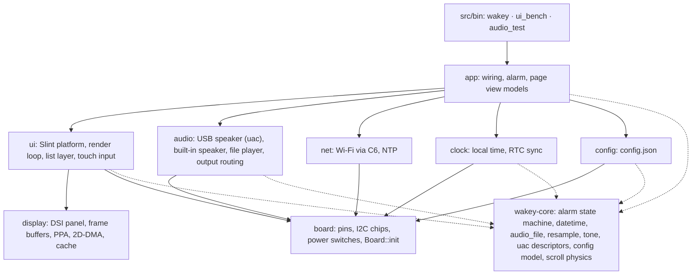
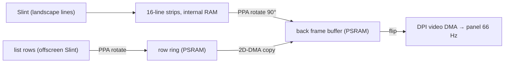
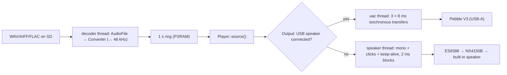

# Architecture

Wakey is a bedside alarm clock on the M5Stack Tab5: a 1280×720 touch clock that plays a sound file from the microSD card on a USB speaker (Creative Pebble V3) at alarm time. This document describes the software as it is. Hardware facts are in [hardware.md](hardware.md), traps already hit in [pitfalls.md](pitfalls.md), what comes next in [roadmap.md](roadmap.md).

## Platform

| | |
| --- | --- |
| SoC | ESP32-P4 **rev v1.3** (2 × RISC-V 360 MHz, 32 MB PSRAM at 200 MHz, 16 MB flash) |
| Radio | ESP32-C6 co-processor on SDIO (esp_hosted firmware by M5Stack) |
| Framework | Rust std on **ESP-IDF 5.5.5** (`esp-idf-sys`/`-hal`/`-svc`) |
| Async | Embassy executor (std platform) on one FreeRTOS task; `embassy-time` driver from `esp-idf-svc` |
| UI | Slint 1.18 software renderer (vendored with two patches) |
| Toolchain | nightly-2026-10-15, `build-std`, target `riscv32imafc-esp-espidf` |

**Rust only:** the project contains no C or C++ of its own and no C board support package. ESP-IDF itself and Espressif's registry components for the Wi-Fi link (`esp_hosted`, `esp_wifi_remote`) are the only C. Panel init tables are ported to Rust; the USB audio class driver is written in Rust on ESP-IDF's USB host library.

Not esp-hal: it supports only P4 rev ≥ v3.0.

## Repository

```
README.md            overview and quick start
docs/                architecture, hardware, pitfalls, roadmap, schematics
wakey-core/          pure logic, host-tested (own Cargo workspace)
firmware/            the firmware (own Cargo workspace, ESP target)
tools/ui-preview/    host tool: renders the firmware's pages to PNG with sample data
spikes/tidal-download/  host tool: download a track from TIDAL (V2 groundwork)
```

## Crates and layers



Each layer uses only the ones below it. Rules that keep it that way:

- **`wakey-core`** has no ESP dependencies. Anything that can be computed without hardware goes there and gets host tests (`cd wakey-core && cargo test`).
- **`board`** owns the hardware facts: pin numbers, I2C addresses, register maps, the bring-up order. `Board::init()` returns owned handles; required chips panic with their name, the SD card is optional.
- **Services** (`ui`, `audio`, `net`, `clock`, `config`) get what they need as arguments: a power [`Switch`](../firmware/src/board/ioexp.rs) instead of the expander, a callback instead of the RTC (`net::start(…, on_time_synced)`).
- **`app`** is the only place that knows the whole product: start-up order, which screen shows what, German UI texts.
- **Binaries** are thin: `wakey` calls `app::main()`; the benches wire what they test.

## Threads and cores

| Task | Stack | Core / prio | Runs |
| --- | --- | --- | --- |
| `main` | 8 KiB | 0 / 1 | logger, starts `app`, then joins it |
| `app` | 64 KiB (internal) | 0 / 1 | Embassy executor: app task (Slint, render loop), touch task |
| `usb-lib` | 4 KiB | any / 5 | ESP-IDF USB host library daemon |
| `uac` | 8 KiB | any / 5 | USB audio client; transfer callbacks call the sample source |
| `decoder` | 8 KiB | 1 / 5 | player: file or tone → 48 kHz → ring (while playing); pinned away from the UI |
| `speaker` | 4 KiB | any / 5 | built-in speaker mixer (I2S): player sound, clicks, keep-alive; amplifier on/off |
| `ui-watch` | 4 KiB | any / 5 | logs where the render loop is when it has not gone round for 2 s |
| `wifi` | 16 KiB | 0 / 1 | Wi-Fi sessions, SNTP, TIDAL jobs (sync, downloads); on core 0 at the UI's priority so a download (TLS, about half a core) leaves the decoder on core 1 alone |
| `card-writer` | 6 KiB | 1 / 4 | during a TIDAL download: writes 128 KiB blocks to the card while the next ones arrive |
| `ambient` | 6 KiB | any / 5 | camera light meter every 10 s; owns and fades the backlight |
| esp_hosted tasks | PSRAM | – | SDIO transport to the C6 |
| `taskstats` | 6 KiB | any / 1 | feature `task-stats` only: CPU time per task every 5 s |

The executor runs on its own task, not on `main`: esp_hosted allocates internal RAM in a C constructor before ESP-IDF creates the main task, and a 64 KiB main stack no longer fits then. The display ISRs are installed from the `app` task, so they run on core 0 with the render loop.

Interrupts end in atomics or `HalIsrNotification`s: DPI frame done (wakes the render loop), PPA done, 2D-DMA done (counters polled by their users), camera frame done (a flag the light meter polls).

## Display sleep

`app::power` (twice a second, UI thread) puts the display to sleep after `power.sleep_after_s` without a touch on the clock page when `power.sleep_when` allows it (`"dark"`: the light meter's night mode, or on battery, read from the INA226 every 5 s: more than 30 mA through the battery shunt; `"always"`; `"never"`), and wakes it when an alarm rings or the condition ends. `ui::power` carries the request to the render loop: asleep, it draws nothing and a touch-down only wakes (the rest of that touch is dropped); awake again once the first fresh frame is presented. The light meter keeps measuring and holds the backlight at 0 while asleep. The panel stays on: its touch stops in sleep mode (`docs/pitfalls.md`). Asleep, it streams at 33 Hz instead of 66 Hz (half the PSRAM reads; it shows nothing at that rate, touch still scans): the render loop rebuilds the display link for each change (`Display::set_pixel_clock`, ~0.45 s, new frame buffers) and repaints the whole window into both buffers after waking. `app::power` also switches the USB-A port (`UsbAudio::set_power`): on only on the alarm pages and from 60 s before something rings, as the Pebble draws ~80 mA even when silent; the clock face shows "no speaker" only if the port has been on for 10 s without one. Switching it off makes the Pebble click (`docs/pitfalls.md`). The built-in speaker's codec and I2S clocks go off with its amplifier (8 s after the last sound) and are set up again before the next one (~3 ms). The chip itself does not sleep: a single tap could not wake it (roadmap, spike `chip_sleep`). Feature `debug-overlay` shows the brightness, the light and the sleep countdown on screen.

## TIDAL

The protocol lives in `wakey_core::tidal` (requests described, answers read, no I/O; host-tested). On the device ([`tidal.rs`](../firmware/src/tidal.rs)) the work runs as a job in a Wi-Fi session ([`net.rs`](../firmware/src/net.rs) `Wifi::run`: the thread powers the C6, connects, runs the job before the NTP sync, and tells the job why if there is no connection). Requests go out through [`http.rs`](../firmware/src/http.rs) (ESP-IDF's HTTP client, servers checked against the full certificate bundle; mbedTLS's buffers in PSRAM, `CONFIG_MBEDTLS_EXTERNAL_MEM_ALLOC`). Login: the sound page's TIDAL tab, without a session, asks for a device code and shows its link as a QR code (`qrcodegen`, ~300 px) with the code; the job polls until the user confirms on the phone (or the tab closes, or the code expires) and writes the session into `config.json` (`config::save_tidal_session`; writes to the file are serialized with the alarms'). The page does not go back to the clock while a login waits. Sync: with a session, every opening of the tab runs a job that refreshes the token if it is about to expire, calls `/v1/sessions` first, finds the playlist (`tidal.playlist`, "Wecker") among the user's own and writes its tracks to `tidal/playlist.json`; the tab lists „Zufällig“ and the tracks (title, artist), selectable. A 401 drops the session and starts a new login in the same Wi-Fi session (QR code at once); a login is followed by the sync right away. While the tab stays open, the job reads the tracks again every 5 s (one request; Wi-Fi stays on until the tab closes); the list is filled again only when it changed. Jobs that arrive while a session is connected (e.g. during a slow NTP sync after boot) run in it, not after it. The glyph lists in `wakey.slint` include typographic quotes and accented letters for track titles.

Downloads: only the tracks the alarms use are downloaded (`Tidal::set_selected`, from the saved alarms and the one being edited: `select_tidal`), all of them if one alarm plays „Zufällig“. A job (`keep_up`) downloads the missing ones one by one, keeps syncing every 5 s while the tab is open, and ends when the tab is closed and nothing is missing; deselecting drops the queued tracks, the running download finishes. Per track: the stream manifest (`playbackinfopostpaywall`, LOSSLESS, `immersiveaudio=false`: otherwise tracks with a Dolby Atmos mix come as E-AC-3 5.1; the answer must say stereo and lossless), then the file into `tidal/<id>.flac.part`: a BTS manifest is one file (mirrors tried in turn), a DASH manifest is segments of fragmented MP4 whose FLAC frames are unpacked into a plain `.flac` while they arrive (`wakey_core::tidal::flac_mp4`). The part must open as FLAC before it is renamed. `http::download` reads with a 16 KiB buffer (lwIP's TCP window 256 KiB, window scaling); TLS uses ChaCha20-Poly1305 (mbedTLS offers it first, TIDAL's CDN takes it), cheaper on this chip than AES-GCM. `CardWriter` hands 128 KiB blocks (cache-line aligned in PSRAM, so the SDMMC DMA needs no bounce buffer) to the `card-writer` thread, four in flight. ~1.2 MiB/s (an 18 MB track in ~15 s; the C6's Wi-Fi buffers per Espressif's P4+C6 profile): the Wi-Fi link through the C6 is the limit (as fast without TLS and without the card), core 0 is ~40 % idle. Feature `download-bench` measures it after boot, `profile-download` profiles core 0 meanwhile. The row of the track being downloaded shows a progress bar (the page polls every 500 ms and moves only the bar); other missing selected tracks say „wird geladen“. An alarm with a `tidal:` sound plays the file (title from the playlist), the built-in tone while it is not on the card. A 401 during downloads drops the session as during a sync.

## Startup with a broken `config.json`

A `config.json` that cannot be read (JSON error, read error) stops the clock on an error page with the parser's message (page 6): no alarms, no Wi-Fi, nothing written, so the file is not replaced by defaults later. A missing file is the first setup: defaults.

## Backlight from the room's light

The Tab5 has no light sensor, so the camera is the light meter ([`ambient.rs`](../firmware/src/ambient.rs), sensor in [`board/camera.rs`](../firmware/src/board/camera.rs)). The sensor is a SmartSens SC202CS (sold as SC2356) at I2C 0x36, set up from Espressif's `esp_cam_sensor` register table (1280×720 RAW8, one MIPI lane at 576 Mbit/s; the 24 MHz clock comes from an oscillator on the board). ESP-IDF's own drivers carry the frames: the MIPI-CSI receiver (`esp_driver_cam`, sharing the display's PHY supply, LDO 3 at 2.5 V) through the ISP (RAW8 → RGB565) into a 1.8 MB buffer in PSRAM; the driver keeps a second, internal buffer for frames nobody asked for. Every 10 s the `ambient` thread wakes the sensor, skips two frames, then steps exposure (8–1244 lines of 26.7 µs) and analog gain (1–16×) until the average of every 8th pixel of every 8th line is between 25 and 200 (~220 ms in all), and puts the sensor back to sleep. Light = average × 1244 / (lines × gain). The panel's backlight barely dims with its PWM duty (1 % is the dimmest visible level, 2–40 % look alike, only above 40 % it gets brighter; see `docs/pitfalls.md`), so the light picks one of three ranges: night (light < 2, left above 4): 1 % and every pixel at 35 % (one multiply per pixel; a full-screen repaint then takes ~110 ms instead of ~70; [`ui/dim.rs`](../firmware/src/ui/dim.rs), in the line path to the PPA, so pages, list rows and slides alike; a change repaints the whole window through a full-screen transparent item and re-renders the list's rows); a lit room (up to 30): 13 %; brighter: 40 % to 100 % on a log scale at 300. Changes fade over 8 s: the backlight in 50 ms steps (`Backlight::set_level`, 14-bit PWM at 4 kHz: ~330 steps in the visible 0–2 %), the pixels in 40 steps (each repaints the window, ~0.2 s). The pixel scaling dithers (4×4 Bayer): cut off, a dimmed gradient showed stripes. No frame is kept: the buffer is overwritten by the next measurement. Without a working camera the backlight stays full.

Shared state: the system I2C bus is `Arc<Mutex<SysI2c>>` (`SharedI2c`), locked per transaction by the expanders, RTC and touch polling. Handles that cross threads (`UsbAudio`, `Wifi`, `IoExpanders`, `Rx8130`) are cheap clones over `Arc`s; commands go through `mpsc` channels, status through `Mutex`/atomics.

## Start-up (`app::main`)

1. `Board::init()`: I2C bus recovery (9 clocks + STOP; the RTC and expanders stay powered across resets) → expanders (rails off, LCD and touch in reset, then released) → RTC configuration → backlight PWM, dark → panel variant from the touch controller → display (DSI PHY LDO, panel init, DPI streaming) → microSD (optional).
2. `clock::init`: time zone, system time from the RTC (or the build time).
3. `config::load`: `config.json` from the card (an old single `alarm` section is migrated to `alarms`; missing settings are added to the file at their defaults).
4. `net::start`: `wifi` thread in sessions (C6 power, esp_hosted transport, driver, connect, NTP → RTC, then all down and the C6 off; next session after `sync_interval_h`, only while the display is awake); NVS is taken once here and shared with the alarm.
5. `Player::new`, then the built-in speaker (`BuiltinSpeaker::start`: I2S0 stream, ES8388 codec, `speaker` thread) with a source from the player. Touch task on the executor.
6. `UsbAudio::start`: USB host, `uac` thread (VBUS, port power, device), with another source from the player.
7. `AlarmClock::new`: alarm state from NVS; it gets an `Output` over both speakers.
8. Slint platform, the pages' view models, clock screen, once-a-second tick (alarms, then view model).
9. `ambient::start` takes the backlight (full, then the room's light); the render loop runs forever.

## Display pipeline



- **Panel:** 720×1280 portrait, 2-lane MIPI-DSI, video mode. Two RGB565 frame buffers in PSRAM (1.8 MB each), streamed continuously by the DPI DMA. Timings from M5GFX: 80 MHz pixel clock, **66.1 Hz**.
- **Flip:** `Display::present()` selects the back buffer for the next frame (the driver switches pointers, no copy). `back_buffer().await` returns after the frame-complete ISR, so rendering is tear-free and paced by the panel. Partial renderers repaint the union of the last two dirty regions (Slint: `RepaintBufferType::SwappedBuffers`).
- **Orientation:** the UI is landscape 1280×720. Landscape `(x, y)` → panel column `y`, row `1279 − x`. Every path uses this mapping.
- **Rendering:** Slint renders unrotated lines into 16-line strips in internal RAM ([`ui/platform.rs`](../firmware/src/ui/platform.rs)); the **PPA** rotates each strip into the frame buffer by DMA while the CPU renders the next ([`display/ppa.rs`](../firmware/src/display/ppa.rs)). The CPU never writes the frame buffer. One PPA transaction in flight, blocks ≤ 640 px wide, strips padded to ≥ 8 lines (chip limitations, see pitfalls).
- **Render loop** ([`ui/render_loop.rs`](../firmware/src/ui/render_loop.rs)): route touch events (the `FrameHook` sees each first and returns a `Route`: Slint's, its own, or taken over from Slint, which then gets a cancel), update Slint timers, wait for the back buffer, let the hook start, render Slint's dirty region, let the hook finish, flip. After a Slint render it renders once more right away, so the other frame buffer is current too (otherwise the next touch's first frame pays for it). When nothing animates: background work for the hook, then sleep until the next Slint timer or touch.
- **List layer** ([`ui/list_layer.rs`](../firmware/src/ui/list_layer.rs)), a `FrameHook`: rows are rendered by a Slint component in an offscreen window and rotated by the PPA into a ring in PSRAM (alarm list: 16 rows, 6 MB), ahead of time in idle frames and again when a row's stamp (a hash of its data) changes. While the list moves, the 2D-DMA copies the visible part into the frame buffer every frame (~11 ms for 1200×588 px, 64 Mpx/s, three times the PPA's rate; the alarm list scrolls at the panel's 66 Hz) while Slint renders the rest. While it is still, the page draws it with the same component (identical pixels, checked by `tools/ui-preview`) and handles taps. Touches go to the page until one moves more than 12 px; then the layer takes it over: mostly vertically it scrolls, sideways on a row it swipes that row. For a swipe it renders pictures of the row (its content over the red underlay, the underlay with "Löschen", and the lit row as the page draws it for the first 28 px, where red corners would show; ~28 ms for the first frame, ~14 ms for the second) and composes every frame from them by 2D-DMA (~5 ms), so the row follows the finger at 66 Hz; released past two thirds of the width, the row is deleted, otherwise it springs back (180 ms) and the page draws it again. A touch on the moving list only stops it. Scroll physics (drag, fling τ 0.35 s, rubber band, critically damped spring) are `wakey_core::scroll::Scroller`. The UI bench uses the layer in its other mode: it always shows the list.
- **Cache:** DMA engines read and write PSRAM, not the cache. [`display/cache.rs`](../firmware/src/display/cache.rs) writes back CPU writes before a DMA reads, and invalidates before the CPU reads DMA output.
- **Touch** ([`ui/input.rs`](../firmware/src/ui/input.rs)): the ST7123's touch half is polled every 10 ms over I2C (clock stretching allowed up to ~13 ms); a release counts after 3 empty readings. After 5 failed reads within a second the touch task releases a held press and pulses `TP_RST`. Events go to the hook first (the list takes drags that start in its area), otherwise to the main Slint window. `input::idle()` is the time since the last touch.

Measured (ST7123, 360 MHz): clock screen tick 110 panel rows, ~1 ms; `ui_bench` scrolling a 300-row list next to Slint content **66 fps** at ~0.8–7 ms CPU per frame.

**UI structure:** `ui/wakey.slint` is one `AppWindow` showing one page at a time (`page`: 0 clock, 1 alarm list, 2 alarm, 3 sound, 4 name); pages live in `ui/wakey/`, with shared colours, icons (`Path`) and controls (buttons, chips, switch, slider, pills) in `theme.slint` and the time wheel in `wheel.slint`. Pages and Rust talk through globals (`Clock`, `AlarmList`, `AlarmEditor`, `SoundPicker`, `NameEditor`); each page has its view model in `src/app/`, and the settings pages share an `app::Ctx` (the alarms, the draft being edited, the click). Switching pages repaints the screen once (40–60 ms; more on the keyboard page, it has ~30 items per line); an edit repaints only what changed (5–20 ms). The alarm list draws its rows from data only and one extra "active" row over the touched one, so touches repaint one row (~19 ms); scrolling is DMA (~11 ms per frame), and the page redraws the list once per frame buffer when it stops (2 × ~41 ms, nothing moves then). `tools/ui-preview` renders every page on the host with sample data (same Slint, same renderer, RGB565) to check layouts without the device.

**Page transitions** ([`ui/transition.rs`](../firmware/src/ui/transition.rs)): every page change goes through `app::show_page`, which asks for a slide (deeper pages from the right, back from the left; the alarm list comes up from the bottom over the clock and goes back down). Buttons that change the page act when touched, not on release. The render loop copies the screen as shown into an "old" picture and slides the new page in over it by 2D-DMA copies (300 ms, ease in and out, the panel's 66 Hz). The slide starts at once (first frame ~25 ms after the tap) while Slint renders the new page into a "new" picture (~65 ms): its frames are driven from the renderer's line callback, and until the page is rendered its part of the screen is the background colour (the slow start brings in only margin by then). Both frame buffers end with "new", and the catch-up render follows. Slint itself would repaint the whole screen every frame of an animated page change (40–60 ms each).

**Icons** (`Icon` in `theme.slint`) are Slint `Path`s. The line-by-line renderer upstream draws no paths at all; the vendored renderer rasterizes them into an alpha map and draws that like a glyph.

**Slint and flash size:** Slint pre-renders every imported font face at every pixel size a `.slint` file uses (ASCII plus the characters of string literals). The clock screen therefore imports one face (Inter Medium), and `build.rs` compiles one `.slint` file per program; each program `include!`s its own generated module. Characters that only come from Rust strings (umlauts in dates and names) must appear in a literal in the `.slint` file (hidden `Text`s in `wakey.slint`). `default-font-family` must be the font's exact family name, "Inter 24pt Medium": with any other name the compiler embeds the system's sans-serif as well and the UI draws with it (see pitfalls). Sizes in use: 30 px secondary text, 40 px primary text and buttons, 64 px numbers, 280 px the clock face; the firmware image is 5.7 MB (45 % of the app partition).

## Audio



- **Output** ([`audio/output.rs`](../firmware/src/audio/output.rs)): the player's sound goes to the USB speaker if one is connected, otherwise to the built-in speaker; never both (they take from the same ring). `Output::update` runs with the alarm clock's tick once a second, so a Pebble unplugged while an alarm rings hands over to the built-in speaker within a second, and back when it returns.

- **USB** ([`audio/uac/`](../firmware/src/audio/uac)): ESP-IDF's USB host library on the high-speed port, switched to full-speed-only (`HCFG.FSLSSupp`) for the full-speed Pebble. The `uac` thread switches VBUS, powers the root port (power-cycling it if nothing enumerates), parses the descriptor (`wakey_core::uac`), claims 48 kHz / 16 bit / stereo, sends `SET_INTERFACE`, sets the sample rate, unmutes, sets the volume (−20 dB below max by default), and tears everything down when the device goes away. `UsbAudio` (`Clone`) controls it: `set_streaming`, `set_volume_db`, `set_mute`, `connected`.
- **Stream:** 3 isochronous transfers × 8 packets × 192 bytes (1 ms of 48 kHz stereo each) in flight; each completion refills its transfer from the `Source` callback and resubmits. 1000 packets/s, no failures measured.
- **Player** ([`audio/player.rs`](../firmware/src/audio/player.rs)): a decoder thread reads the file (`wakey_core::audio_file`), converts other rates with rubato's FFT resampler (`wakey_core::resample`; 44.1 kHz: 1029-frame blocks) into a one-second ring; the source drains it and plays silence (counted as underrun) when empty. 0 underruns measured for 48 kHz AIFF and 44.1 kHz WAV. `Player::play` plays a file once; `Player::ring` loops a file, or the built-in double beep (`wakey_core::tone`) when there is no file or it cannot be read, and the source applies the gain and a squared fade-in.
- **Volume:** the device volume (−20 dB below its maximum) is the cap; the alarm's `volume` (1–100 %: never silent; a 0 in the file is read as 1) is a digital gain below it (`tone::volume_gain`: −40 dB at 1 %, 0 dB at 100 %). `Player::set_gain` changes it while playing (the sound page's slider during a preview).
- **Built-in tone:** one period of the double beep (1 s) is computed once and played from a table; per-sample `sin` took a whole core (see pitfalls).
- **Built-in speaker** ([`audio/builtin.rs`](../firmware/src/audio/builtin.rs), [`board/codec.rs`](../firmware/src/board/codec.rs)): the ES8388 codec (I2C 0x10, register values from M5Unified with two changes after Espressif's driver: MCLK ratio 256, state machine restart) on I2S0 at 48 kHz, through the NS4150B amplifier (`SPK_EN`). The `speaker` thread mixes 2 ms blocks (`wakey_core::mix`): the player's sound while streaming (to mono: the amplifier takes the left channel only), a click on top, and always an inaudible keep-alive signal (exact zeros let the chain mute, and lone clicks and the first beep after a pause lost their start). The click: 10 ms at a quarter of full scale (`tone::click`: 1.2 kHz, 0.3 ms attack, 2 ms decay) per wheel tick (at most one per frame), quieter the closer it follows the previous one (`tone::click_gain`: full from 100 ms apart, 0.6 at 20 ms). The amplifier is on while streaming, from `BuiltinSpeaker::wake` (the alarm page opens; renewed by its 5 s refresh) or a click, until 8 s without either; off, the thread sleeps and the stream plays silence by itself (`auto_clear`).

## Alarm

- **Logic** (`wakey_core::alarm`, host-tested): several alarms (`AlarmConfig`: id, optional name, on/off, time, weekdays, sound, volume, fade-in) and one `RingConfig` (snooze, max snoozes, ring timeout) for all. `Alarms::tick(alarms, ring, now)` once a second, `Alarms::input(Snooze | Stop)`, `Alarms::ringing()`, `Alarms::next()` / `next_of()` for the display. One alarm is active at a time: idle → ringing → (snoozed → ringing)* → idle. Each rings on its weekdays at most once per day; snooze at most `max_snoozes` (3) times for `snooze_min`; stop ends the day, also while snoozed; unanswered it is silenced after `ring_timeout_min` for good. An alarm due while another is snoozed takes over; one due while another rings is folded into that ringing. Local time decides when one is due, Unix time measures durations: an alarm in the skipped spring hour rings at 03:00, one in the repeated autumn hour rings once. After a boot it still rings if its time is less than the ring timeout ago; an alarm time crossed by a large clock jump (NTP) does not ring. Deleting or switching off the active alarm ends it.
- **Sound** (`wakey_core::alarm::Sound`, a string in `config.json`): `"beep"` (built-in tone), a file path (`"sounds/x.wav"`), `"random"` (a file from `sounds/`, chosen by `pick_daily` from the date and the alarm id: fixed for the day, so a reboot while ringing plays the same one), `"tidal:random"` / `"tidal:<id>"` (a downloaded track from `tidal/`, chosen like `"random"` for the former; the built-in tone while none is there). [`sounds.rs`](../firmware/src/sounds.rs) lists `sounds/*.wav|aif|aiff|flac` (FLAC decoded with `claxon` in `wakey_core::audio_file`) and resolves a `Sound` to a file.
- **Device** ([`app/alarm.rs`](../firmware/src/app/alarm.rs)): `AlarmClock` runs the state machine on the UI thread, saves its state as JSON in NVS (namespace `wakey`, key `alarms`: the active phase and each alarm's last finished day) whenever it changes, so a reboot neither rings a finished alarm again nor loses a snooze or a ringing alarm, and makes the speaker follow: ringing → `Output::set_streaming(true)` + `Player::ring` with that alarm's sound, volume and fade-in, otherwise stop. Without a USB speaker the alarm rings on the built-in one; a USB speaker that connects later takes over within a second. `save` / `delete` / `set_enabled` write the `alarms` list into `config.json` (`config::save_alarms`: rest of the file kept, through a temporary file) and then apply it (`Alarms::reconfigured`: an alarm already stopped today rings again today only if moved to a time still ahead). `preview` plays an alarm's sound without fade-in for the sound page (not while one rings).
- **Settings pages** (`ui/wakey/*.slint`, view models in `src/app/`):
  - *Alarm list* (`alarm_list`): tapping the alarm line on the clock page opens it. One row per alarm, sorted by time, the next one's time in amber; tap a row to edit, its switch for on/off (animated: rows are updated in place, not re-created), switched or next-alarm colour changes fade (250 ms); swipe it left past two thirds of the width to delete it ("Löschen" shows on red behind it; a shorter swipe springs back; the list layer draws the swipe); "+ Neu" adds one (07:00, Mo–Fr). Scrolling is the list layer's (above); the page handles taps of the still list with one touch area. A row held for 40 ms lights up at once (a quick flick passes the 12 px first, so it changes nothing on the page); the lit row is drawn as one extra "active" row over the plain rows, which never depend on touch state.
  - *Alarm* (`alarm_page`): hour and minute wheels (drag, flick, snap, wrap around; each row passing the band clicks on the built-in speaker), "Klingelt in …"; a card with the name, weekday chips as wide as the card allows, and one "Klang" row (sound, volume bars, fade-in icon and time) that opens the sound page. Edits go to a draft; Sichern needs a weekday and saves, Abbrechen drops the draft.
  - *Sound* (`sound_page`): Datei / TIDAL (see TIDAL above); built-in tone, "Zufällig" and the files (without files on the card only the tone and a note that there are none); volume slider (no number), fade-in (aus, 10, 30, 60 s; the card is exactly as wide as these pills, the list takes the rest), "Probehören".
  - *Name* (`name_page`): QWERTZ keyboard with umlauts and a digit layer; Rust edits the text (24 characters at most).
  - Any settings page goes back to the clock after 60 s without a touch (not during a preview) and when an alarm rings.
- **Ringing screen** (clock page): while ringing the digits turn amber; a tap anywhere snoozes (while snoozes are left); stop is a smaller button in the top-right corner that has to be held for 1.5 s (a filling bar), deliberately harder than snooze. While snoozed the bottom line shows until when, and the stop button stays. Idle, the bottom line shows an alarm clock symbol and the next alarm ("Morgen 06:30"); touching it opens the alarm list.
- **Clock page** (`clock_page`, `app/clock_screen.rs`): the background is a sky that follows the sun (`wakey_core::sky`: the sun's elevation over Zurich, NOAA's approximation, picks and blends five colours, top to bottom, from keys modelled on macOS's "Solar Gradients" by day, with a nearly black and purple night and plum twilight (red-leaning: blue-leaning purples look blue on the panel), a glowing orange horizon at sunrise and sunset, saturated blue by day; mornings and evenings have their own keys). While the horizon is light the bottom line (alarm, symbols) turns dark. It is computed for the minute, so it changes at most once a minute (a whole-screen repaint, ~66 ms per buffer, dithered by the vendored renderer); a slide back to the clock fills the not yet rendered part with the sky's middle colour. Text other than the digits is translucent white. The time is one string ("07:38") drawn one character per `Roll` item (`theme.slint`), each as wide as its glyph, so the spacing is the font's; a changed digit rolls (the old one up and out, the new one up from below, 400 ms, clipped to its item), the date rolls as a whole. A seconds roll costs ~3 ms per frame for its 400 ms. Speaker and network show only when missing: a "no speaker" symbol without the USB speaker (alarms then ring on the built-in one), a "no network" symbol when Wi-Fi failed or is not set up.

## Time

- The **RX8130 RTC** keeps UTC on a supercap (≈ 7 h). `Rx8130::get_time` rejects the power-loss flag, non-BCD values and implausible dates.
- `clock::init` sets `TZ=CET-1CEST,M3.5.0,M10.5.0/3` (newlib applies the DST rule) and the system clock from the RTC; with no valid RTC time it uses the firmware build time (`BUILD_UNIX_TIME` from `build.rs`) and writes it back.
- After an **NTP** sync on the `wifi` thread, the app's callback writes the system time to the RTC (`clock::store_system_time`).
- The clock screen updates on the second: a one-shot timer to the next full second, then a 1 s repeating timer. `clock::moment()` gives local and Unix time of the same instant (for the alarm).

## Network

The C6 behaves as the normal `esp_wifi` driver through `esp_wifi_remote`, so `EspWifi`/`BlockingWifi` work unchanged. `net::start` runs the `wifi` thread: C6 power (expander WLAN_PWR_EN), driver up (~2.8 s including the C6 reset), connect with back-off (5 s doubling to 5 min), SNTP while connected, status for the UI (`net::Status`: starting, not configured with networks in range, connecting, connected with IP/RSSI/NTP, failed). Without credentials it scans once and switches the radio off.

## Memory

| | Internal RAM | PSRAM |
| --- | --- | --- |
| Frame buffers | – | 2 × 1.8 MB |
| PPA strips | 4 × 40 KiB | – |
| `app` stack | 64 KiB | – |
| List ring (`ui_bench`) | – | 7.5 MB |
| Player ring | – | 192 KiB |
| esp_hosted pools, task stacks | – | yes |
| Free while running `wakey` | ~110 KiB (~70 KiB of it DMA-capable) | ~23 MB |

`CONFIG_SPIRAM_MALLOC_ALWAYSINTERNAL=0`: `malloc` takes PSRAM first; internal RAM is left to what asks for it (DMA buffers, FreeRTOS objects, stacks). Small allocations kept internal (the default) let Slint fill internal RAM, after which drivers and `std` failed (see pitfalls). Cached PSRAM loads take as long as internal ones. The per-second stats line shows free internal and DMA memory. Lints `large_stack_frames` and `mem_forget` are denied.

## Build

- `firmware/.cargo/config.toml`: target, `build-std`, runner `scripts/flash.sh` (flashes with ESP-IDF's bootloader, built for rev < v3, and `partitions.csv`: 12 MB app, NVS).
- `esp-idf-sys` builds ESP-IDF 5.5.5 into `firmware/.embuild/` (first build ~10 min; every `sdkconfig.defaults` change rebuilds much of it). `[package.metadata.esp-idf-sys]` adds bindings (`bindings/extra.h`: PPA) and the registry components `esp_hosted` 2.13.1 and `esp_wifi_remote` 1.6.5.
- `build.rs`: compiles `ui/wakey.slint` and `ui/ui_bench.slint` (fonts pre-rendered for the software renderer, style `fluent-dark`), exports `BUILD_UNIX_TIME`. The renderer's `path` feature is on (icons).
- Vendored crates (`firmware/vendor/`, `[patch.crates-io]`): Slint's renderer (glyph fast path), `i-slint-core` (16 dirty rectangles instead of 3, and rectangles sharing lines merged into one band) and `esp-idf-svc` (one impl compiled out to avoid a rustc ICE). See [vendor/README.md](../firmware/vendor/README.md).
