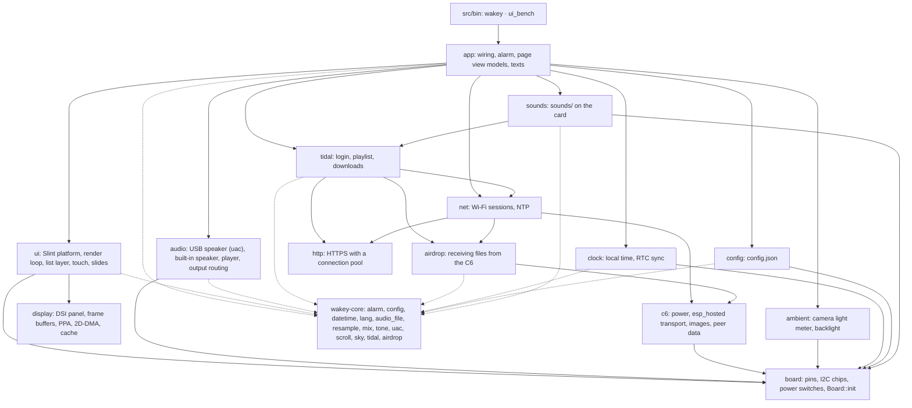
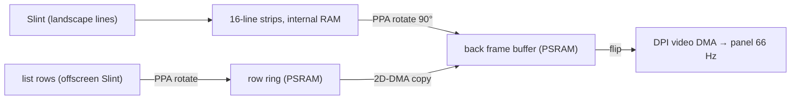
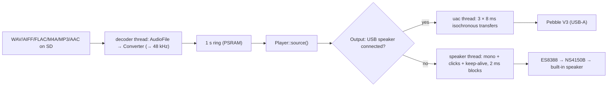

# Architecture

Wakey is a bedside alarm clock on the M5Stack Tab5: a 1280×720 touch clock that plays a sound file from the microSD card on a USB speaker (Creative Pebble V3), or on the built-in speaker, at alarm time. This document describes the software. Hardware facts are in [hardware.md](hardware.md), traps met on this board and the fixes in place in [pitfalls.md](pitfalls.md), known limitations and possible next steps in [roadmap.md](roadmap.md), what to re-check when a dependency is updated in [upgrades.md](upgrades.md). Building and the source layout: [firmware/README.md](../firmware/README.md).

## Platform

| | |
| --- | --- |
| SoC | ESP32-P4 **rev v1.3** (2 × RISC-V 360 MHz, 32 MB PSRAM at 200 MHz, 16 MB flash) |
| Radio | ESP32-C6 co-processor on SDIO: esp_hosted 2.13.1 with Wakey's addition, or the AirDrop receiver ([`firmware/c6/`](../firmware/c6/README.md)) |
| Framework | Rust std on **ESP-IDF 5.5.5** (`esp-idf-sys`/`-hal`/`-svc`) |
| Async | Embassy executor (std platform) on one FreeRTOS task; `embassy-time` driver from `esp-idf-svc` |
| UI | Slint 1.18 software renderer (vendored with patches, see [vendor/README.md](../firmware/vendor/README.md)) |
| Toolchain | the nightly pinned in [`rust-toolchain.toml`](../firmware/rust-toolchain.toml) (the only one that builds, see [pitfalls.md](pitfalls.md#platform-and-build)), `build-std`, target `riscv32imafc-esp-espidf` |

**Rust only on the P4:** the firmware contains no C or C++ of its own and no C board support package. ESP-IDF itself (one component vendored with a small change: `esp_lcd`, see [vendor/README.md](../firmware/vendor/README.md)) and Espressif's registry components for the Wi-Fi link (`esp_hosted`, `esp_wifi_remote`) are the only C. Panel init tables are ported to Rust; the USB audio class driver is written in Rust on ESP-IDF's USB host library. The C6's two images (esp_hosted with Wakey's addition, the AirDrop receiver) are C, as esp_hosted itself.

Not esp-hal: it supports only P4 rev ≥ v3.0.

## Repository

```
README.md            overview, configuration, licensing
docs/                architecture, hardware, pitfalls, roadmap, upgrades
wakey-core/          pure logic, host-tested (own Cargo workspace); lang/: the screen's texts per language
firmware/            the firmware (own Cargo workspace, ESP target)
firmware/c6/         the C6's images and their sources (esp_hosted addition, AirDrop receiver, rescue tool)
tools/ui-preview/    host tool: renders the firmware's pages to PNG with sample data
```

## Crates and layers



Support modules used throughout: `runtime` (the `Thread` helper and the executor), `psram` (cache-line aligned PSRAM buffers for DMA, freed on drop), `taskstats` (feature `task-stats`).

Rules that keep the layering:

- **`wakey-core`** has no ESP dependencies. Anything that can be computed without hardware goes there and gets host tests (`cd wakey-core && cargo test`).
- **`board`** owns the hardware facts: pin numbers, I2C addresses, register maps, the bring-up order. `Board::init()` returns owned handles; required chips panic with their name, the SD card is optional.
- **Services** (`ui`, `audio`, `net`, `tidal`, `airdrop`, `ambient`, `clock`, `config`, `sounds`) get what they need as arguments: a power [`Switch`](../firmware/src/board/ioexp.rs) instead of the expander, a callback instead of the RTC, and from the app what they need to know of the UI as plain functions: `net::start(net::Setup { …, display_asleep }, on_time_synced)`, `ambient::start(…, ambient::Screen { asleep, pixels, set_pixels, full }, …)`. Services report types (`net::Unavailable`, `tidal::Problem`, `airdrop::State`); the details go to the log.
- **`app`** is the only place that knows the whole product: start-up order, which page shows what, and in which words (`app/texts.rs`: the language's texts, see [Language](#language)).
- **Binaries** are thin: `wakey` calls `app::main()`; `ui_bench` wires the list layer and Slint for measuring.

## Threads and cores

All threads are spawned through `runtime::Thread` (name, stack, optional core, priority and stack in PSRAM); ESP-IDF's default priority for `std` threads is 5.

| Task | Stack | Core / prio | Runs |
| --- | --- | --- | --- |
| `main` | 8 KiB | 0 / 1 | logger, starts `app`, then joins it |
| `app` | 64 KiB (internal) | 0 / 1 | Embassy executor: the app task (Slint, render loop); with `ui-bench` also the scripted gestures |
| `touch` | 6 KiB | 1 / 6 | polls the touch controller every 10 ms, queues pointer events |
| `usb-lib` | 4 KiB | any / 5 | ESP-IDF USB host library daemon |
| `uac` | 8 KiB | any / 5 | USB audio client; transfer callbacks call the sample source |
| `decoder` | 64 KiB (PSRAM) | 1 / 5 | player: file or tone → 48 kHz → ring (while playing); pinned away from the UI |
| `speaker` | 4 KiB | any / 5 | built-in speaker mixer (I2S): player sound, clicks, keep-alive; amplifier on/off |
| `ui-watch` | 4 KiB | any / 5 | logs where the render loop is when it has not gone round for 2 s |
| `wifi` | 16 KiB | 1 / 1 | Wi-Fi sessions, SNTP, TIDAL jobs (sync, downloads), AirDrop |
| `card-writer` | 6 KiB | 1 / 4 | during a TIDAL download: writes 32 KiB blocks to the card while the next ones arrive |
| `cover` | 64 KiB (PSRAM) | any / 5 | decodes one album cover (JPEG) during a sync, joined at once |
| `ambient` | 6 KiB | any / 5 | camera light meter every 10 s; owns and fades the backlight |
| esp_hosted tasks | PSRAM | – | SDIO transport to the C6 and its RPC |
| `task-stats` | 6 KiB | any / 5 | feature `task-stats` only: CPU time per task every 5 s |

The executor runs on its own task, not on `main`: esp_hosted allocates internal RAM in a C constructor before ESP-IDF creates the main task, and a 64 KiB main stack does not fit then. The display ISRs are installed from the `app` task, so they run on core 0 with the render loop.

Touch has its own thread because a task on the UI's executor waits behind long frames (a page change, the clock's minute): polls up to 90 ms apart leave a fling too few points to measure its speed. On core 1 at priority 6 it is above the decoder, which would otherwise hold it off; a poll takes well under a millisecond.

The `wifi` thread runs on core 1 at priority 1, below the decoder and the card writer: a download (TLS) takes about half a core, and at the UI's priority on core 0 it makes animations stutter.

Interrupts end in atomics or `HalIsrNotification`s: DPI frame done (wakes the render loop), PPA done, 2D-DMA done (counters polled by their users), camera frame done (a flag the light meter polls).

Shared state: the system I2C bus is `Arc<Mutex<SysI2c>>` (`SharedI2c`), locked per transaction by the expanders, RTC, touch, INA226, codec and camera sensor drivers. Handles that cross threads (`UsbAudio`, `Wifi`, `Tidal`, `IoExpanders`, `Rx8130`) are cheap clones over `Arc`s; commands go through `mpsc` channels, status through `Mutex`es and atomics.

## Start-up (`app::main`)

1. `Board::init()`: I2C bus recovery (9 clocks + STOP; the RTC and expanders stay powered across resets) → expanders (rails off, LCD and touch in reset, then released) → RTC configuration → backlight PWM, dark → panel variant from the touch controller → display (DSI PHY LDO, panel init, DPI streaming) → microSD (optional).
2. `clock::init`: system time from the RTC (or the build time).
3. `config::load`: `config.json` from the card; settings missing from the file are added at their defaults. A file that cannot be read stops here (below). Then the language (`texts::init`) and the time zone (`clock::set_time_zone`).
4. `net::start`: the `wifi` thread (sessions, below). NVS is taken once here and shared with the alarm.
5. `Player::new`, then the built-in speaker (`BuiltinSpeaker::start`: I2S0 stream, ES8388 codec, `speaker` thread) with a source from the player.
6. `input::start`: the `touch` thread.
7. `UsbAudio::start`: USB host, `uac` thread (USB-A 5 V, root port, device), with another source from the player.
8. `AlarmClock::new`: alarm state from NVS; it gets an `Output` over both speakers.
9. Slint platform, the window, the pages' view models, the list layers, the idle timeout, `app::power`, the clock screen's once-a-second tick (alarms, then view model).
10. `ambient::start` takes the backlight (full, then the room's light); the render loop runs forever.

**A broken `config.json`:** a file that cannot be read (JSON error, read error) stops the clock on an error page (`Page::ConfigError`) with the parser's message: no alarms, no Wi-Fi, nothing written, so the file is not replaced by defaults later. A missing file is the first setup: defaults.

## Display pipeline



- **Panel:** 720×1280 portrait, 2-lane MIPI-DSI, video mode. Two RGB565 frame buffers in PSRAM (1.8 MB each), streamed continuously by the DPI DMA. Timings from M5GFX: 80 MHz pixel clock, **66.1 Hz**.
- **Flip:** `Display::present()` selects the back buffer for the next frame (the driver switches pointers, no copy). `back_buffer().await` returns after the frame-complete ISR, so rendering is tear-free and paced by the panel. Partial renderers repaint the union of the last two dirty regions (Slint: `RepaintBufferType::SwappedBuffers`).
- **Orientation:** the UI is landscape 1280×720. Landscape `(x, y)` → panel column `y`, row `1279 − x`. Every path uses this mapping.
- **Rendering:** Slint renders unrotated lines into 16-line strips in internal RAM ([`ui/platform.rs`](../firmware/src/ui/platform.rs)); the **PPA** rotates each strip into the frame buffer by DMA while the CPU renders the next ([`display/ppa.rs`](../firmware/src/display/ppa.rs)). The CPU does not render into the frame buffer (the one exception is the list's corner caps, below). One PPA transaction in flight, blocks ≤ 640 px wide, strips padded to ≥ 8 lines (chip limitations, see [pitfalls.md](pitfalls.md#display)). The PPA moves ~20 Mpx/s; bulk copies go through the **2D-DMA** ([`display/dma2d.rs`](../firmware/src/display/dma2d.rs), 64 Mpx/s): `OwnedPicture`s own their PSRAM, a `Blit` describes one rectangle copy, and each `FbCopy` counts its own completions.
- **Cache:** DMA engines read and write PSRAM, not the cache. [`display/cache.rs`](../firmware/src/display/cache.rs) writes back CPU writes before a DMA reads, and invalidates before the CPU reads DMA output.
- **Render loop** ([`ui/render_loop.rs`](../firmware/src/ui/render_loop.rs)): route touch events (the `FrameHook` sees each first and returns a `Route`: Slint's, its own, or taken over from Slint, which then gets a cancel), update Slint timers, wait for the back buffer, let the hook start, render Slint's dirty region, let the hook finish, flip. After a Slint render it renders once more right away, so the other frame buffer is current too (otherwise the next touch's first frame pays for it). When nothing animates: background work for the hook, then sleep until the next Slint timer or touch. A Slint render over 35 ms logs its dirty rectangles (`slint: slow frame`); the loop's stage is kept for `ui-watch`.
- **Touch** ([`ui/input.rs`](../firmware/src/ui/input.rs)): the `touch` thread polls the ST7123's touch half every 10 ms over I2C (clock stretching allowed up to ~13 ms); a release counts after 3 empty readings. After 5 failed reads within a second it releases a held press and pulses `TP_RST`. Events are queued with their read time; the render loop drains the queue once per frame and gives them to the hook first (the list takes drags that start in its area), otherwise to the main Slint window. `input::idle()` is the time since the last touch.

### List layer

[`ui/list_layer/`](../firmware/src/ui/list_layer/mod.rs) is a `FrameHook` that scrolls a list by DMA instead of having Slint repaint it. A full-width list redrawn by Slint is bound by the PPA's rate (~24 fps); the layer scrolls at the panel's 66 Hz.

- **Rows** are rendered by a Slint component in an offscreen window (a second `AppWindow` on `Page::AlarmListRow` or `Page::SoundListRow`) and rotated by the PPA into a ring in PSRAM (alarm list: 16 slots, 6 MB), ahead of time in idle frames and again when a row's stamp (a hash of its data) changes.
- **Moving:** every frame the 2D-DMA copies the visible part into the frame buffer (~11 ms for 1200×588 px) while Slint renders the rest. Scroll physics (drag, fling τ 0.35 s, rubber band, critically damped spring) are `wakey_core::scroll::Scroller`. A touch on the moving list only stops it.
- **Still:** the page draws the list with the same component (identical pixels, checked by `tools/ui-preview`) and handles taps. Touches go to the page until one moves more than 12 px; then the layer takes it over: mostly vertically it scrolls, sideways on a row it swipes that row.
- **Swipe:** the layer renders pictures of the row (its content over the red underlay, the underlay with "Delete", and the lit row as the page draws it for the first 28 px, where red corners would show; ~28 ms for the first frame, ~14 ms for the second) and composes every frame from them by 2D-DMA (~5 ms), so the row follows the finger at 66 Hz. Released past two thirds of the width, the row is deleted; otherwise it springs back (180 ms) and the page draws it again.
- **Two lists, one ring:** the sound page's list (the tab shown) scrolls on a second layer (`sound_page::layer`, rows rendered by an offscreen `SoundRowItem`, no swiping: sideways drags stay the page's). The two pages are never on screen together, so it draws into the alarm list's buffers (`SharedLayers`: the layer shown owns them and renders its rows again when it takes them over; 36 rows of 660×112 px fit). A list longer than the ring renders the rows it reaches while scrolling (the time per row is logged at debug level).
- **Rounded card corners:** Slint clips rectangles only, so the page draws caps over the list's corners (page background outside the rounding, anti-aliased with 4 × 4 samples: `list_layer::corner_alpha`; the radii come from the Slint layouts), and the layer blends the same caps into the frame buffer after its copies (~700 pixels per frame, by the CPU).
- **Marquee:** the sound rows' scrolling text follows a clock (`SoundPicker.marquee-ms`, advanced every 25 ms by a timer while the page draws the list, paused while the layer moves it), so it stands still during a scroll (the visible rows are rendered again at its start with the page's time) and goes on from there afterwards.

The UI bench uses the layer in its other mode: it always shows the list.

### Pages

`ui/wakey.slint` is one `AppWindow` showing one page at a time (`page: Page`, a Slint enum: `clock`, `alarm-list`, `alarm`, `sound`, `name`, `config-error`, and the two offscreen row pages); pages live in `ui/wakey/`, with shared colours, icons (`Path`) and controls (buttons, chips, switch, slider, volume bars, pills, marquee) in `theme.slint` and the time wheel in `wheel.slint`. Values Rust and Slint share are Slint enums too (`SoundTab`, `SoundRowKind`, `TidalView`, `AlarmPhase`, …), not numbers. Pages and Rust talk through globals (`Clock`, `AlarmList`, `AlarmEditor`, `SoundPicker`, `NameEditor`); each page has its view model in `src/app/`, and the settings pages share an `app::Ctx` (the alarms, the draft being edited, the click, TIDAL, the sound page's state).

Costs on the device: switching pages repaints the screen once (40–60 ms; more on the keyboard page, which has ~30 items per line); an edit repaints only what changed (5–20 ms). The alarm list draws its rows from data only and one extra "active" row over the touched one, so a touch repaints one row (~19 ms); scrolling is DMA (~11 ms per frame), and the page redraws the list once per frame buffer when it stops (2 × ~41 ms, nothing moves then). The clock's seconds tick touches ~110 panel rows (~1 ms); `ui_bench` scrolls a 300-row list next to Slint content at **66 fps** with ~0.8–7 ms CPU per frame. `tools/ui-preview` renders every page on the host with sample data (same Slint, same renderer, RGB565) to check layouts without the device.

**Page transitions** ([`ui/transition.rs`](../firmware/src/ui/transition.rs)): every page change goes through `app::show_page`, which asks for a slide (deeper pages from the right, back from the left; the alarm list comes up from the bottom over the clock and goes back down) and, when the sound page is left, ends what it runs (TIDAL's tab, AirDrop, a preview), whatever made it go. Buttons that change the page act when touched, not on release. The render loop copies the screen as shown into an "old" picture and slides the new page in over it by 2D-DMA copies (300 ms, ease in and out, the panel's 66 Hz). The slide starts at once (first frame ~25 ms after the tap) while Slint renders the new page into a "new" picture (~65 ms): its frames are driven from the renderer's line callback, and until the page is rendered its part of the screen is a background colour (the clock's sky or the settings pages' background; the slow start brings in only margin by then). Both frame buffers end with "new", and the catch-up render follows. Slint itself would repaint the whole screen every frame of an animated page change (40–60 ms each).

**Icons** (`Icon` in `theme.slint`) are Slint `Path`s. Upstream's line-by-line renderer draws no paths; the vendored renderer rasterizes them into an alpha map and draws that like a glyph.

**Fonts and flash size:** Slint pre-renders every imported font face at every pixel size a `.slint` file uses (ASCII plus the characters of string literals). The UI therefore imports one face (Inter Medium), and `build.rs` compiles one `.slint` file per program; each program `include!`s its own generated module. Characters that only come from Rust strings (the languages' texts, names, typographic quotes and accented letters in track titles) must appear in a literal in the `.slint` file (hidden `Text`s in `wakey.slint`; a test in `wakey_core::lang` checks the language files against them). `default-font-family` must be the font's exact family name, "Inter 24pt Medium": with any other name the compiler embeds the system's sans-serif as well and the UI draws with it. Sizes in use: 30 px secondary text and the debug overlay, 40 px primary text and buttons, 64 px numbers, 72 px the alarm page's wheels, 280 px the clock face. `cargo run` prints the image's share of the 12 MB app partition (`App/part. size`).

## Display sleep

`app::power` (twice a second, on the UI thread) puts the display to sleep after `power.sleep_after_s` without a touch on the clock page when `power.sleep_when` allows it (`"dark"`: the light meter's night mode, or on battery, read from the INA226 every 5 s: more than 30 mA through the battery shunt; `"always"`; `"never"`), and wakes it when an alarm rings or the condition ends; a display that wakes by itself restarts the idle time (`input::restart_idle`). `ui::power` carries the request to the render loop: asleep, it draws nothing and a touch-down only wakes (the rest of that touch is dropped); awake again once the first fresh frame is presented. The light meter keeps measuring and holds the backlight at 0 while asleep.

- **The panel stays on:** in sleep mode the ST7123's touch stops scanning. Asleep, it streams at 33 Hz instead of 66 Hz (half the PSRAM reads; the panel shows nothing at that rate, touch still scans): the render loop rebuilds the display link for each change (`Display::set_pixel_clock`, ~0.45 s) and repaints the whole window into both buffers after waking. The frame buffers are kept across rebuilds (`display::FB_POOL`, through the vendored `esp_lcd`): freed and allocated anew, they came back too fragmented.
- **USB-A:** `app::power` also switches USB-A's 5 V (`UsbAudio::set_power`): on only on the settings pages and from 60 s before something rings, as the Pebble draws ~80 mA even when silent; the clock face shows "no speaker" only if USB-A has been on for 10 s without one. Switching it off makes the Pebble click.
- **Built-in speaker:** its codec and I2S clocks go off with its amplifier (8 s after the last sound) and are set up again before the next one (~3 ms).
- **The chip itself does not sleep:** a single tap must wake the clock, and the ST7123 cannot report one from chip light sleep (see [pitfalls.md](pitfalls.md#touch-and-i2c)). Power states and measurements: [hardware.md](hardware.md#power-states).

Feature `debug-overlay` shows the pixel dimming, the backlight level, the light and the sleep countdown on screen.

## Backlight from the room's light

The Tab5 has no light sensor, so the camera is the light meter ([`ambient.rs`](../firmware/src/ambient.rs), sensor in [`board/camera.rs`](../firmware/src/board/camera.rs)). The sensor is a SmartSens SC202CS (sold as SC2356) at I2C 0x36, set up from Espressif's `esp_cam_sensor` register table (1280×720 RAW8, one MIPI lane at 576 Mbit/s, 5 fps; the 24 MHz clock comes from an oscillator on the board). ESP-IDF's own drivers carry the frames: the MIPI-CSI receiver (`esp_driver_cam`, sharing the display's PHY supply, LDO 3 at 2.5 V) through the ISP (RAW8 → RGB565) into a 1.8 MB buffer in PSRAM; the driver keeps a second, internal buffer for frames nobody asked for.

Every 10 s the `ambient` thread wakes the sensor, skips two frames, then steps exposure (8–1244 lines of 26.7 µs) and analog gain (1–16×) until the average of every 8th pixel of every 8th line is between 25 and 200 (a frame takes 200 ms at 5 fps; the `ambient: mean …` log line gives the frames and the time of each measurement), and puts the sensor back to sleep. Light = average × 1244 / (lines × gain). No frame is kept: the buffer is overwritten by the next measurement. Without a working camera the backlight stays full.

The panel's backlight barely dims with its PWM duty (1 % is the dimmest visible level, 2–40 % look alike, only above 40 % it gets brighter), so the light picks one of three ranges:

| Light | Backlight | Pixels |
| --- | --- | --- |
| night: < 2 (left above 4) | 1 % | scaled to `display.night_pixels_percent` (35 %) |
| a lit room: up to 30 | 13 % | full |
| brighter | 40 % to 100 % on a log scale at 300 | full |

Pixel scaling ([`ui/dim.rs`](../firmware/src/ui/dim.rs)) is one multiply per pixel in the line path to the PPA, so pages, list rows and slides alike; it dithers (4×4 Bayer), as a cut-off dimmed gradient shows stripes. A full-screen repaint then takes ~110 ms instead of ~70. A change repaints the whole window through a full-screen transparent item and re-renders the list's rows. Changes fade over 8 s: the backlight in 50 ms steps (`Backlight::set_level`, 14-bit PWM at 4 kHz: ~330 steps in the visible 0–2 %), the pixels in 40 steps (each repaints the window, ~0.2 s).

## Audio



- **Output** ([`audio/output.rs`](../firmware/src/audio/output.rs)): the player's sound goes to the USB speaker if one is connected, otherwise to the built-in speaker; never both (they take from the same ring). `Output::update` runs with the alarm clock's tick once a second, so a Pebble unplugged while an alarm rings hands over to the built-in speaker within a second, and back when it returns.
- **USB** ([`audio/uac/`](../firmware/src/audio/uac)): ESP-IDF's USB host library on the high-speed port, switched to full-speed-only (`HCFG.FSLSSupp`) for the full-speed Pebble. The `uac` thread switches USB-A's 5 V, powers the root port once and keeps it powered (if nothing enumerates within 3 s it cycles the 5 V, up to five times until USB-A is next switched on, and never the root port: powering the port down during enumeration aborts ESP-IDF's hub driver), parses the descriptor (`wakey_core::uac`), claims 48 kHz / 16 bit / stereo, sends `SET_INTERFACE`, sets the sample rate, unmutes, sets the volume (20 dB below the device's maximum), and tears everything down when the device goes away. The driver's callbacks run on that thread inside its event pump; what they share with it (`CallbackState`: flags, counters, the sample source) is reached only through shared references and cells. A control request that gets no answer within 2 s is given up: its transfer is freed by its own callback when the driver returns it, and cannot complete a later request. `UsbAudio` (`Clone`) controls it: `set_streaming`, `set_power`, `connected`, `missing`.
- **Stream:** 3 isochronous transfers × 8 packets × 192 bytes (1 ms of 48 kHz stereo each) in flight; each completion refills its transfer from the `Source` callback and resubmits. 1000 packets/s, no failures measured.
- **Player** ([`audio/player.rs`](../firmware/src/audio/player.rs)): a decoder thread reads the file (`wakey_core::audio_file`), converts other rates with rubato's FFT resampler (`wakey_core::resample`; 44.1 kHz: 1029-frame blocks) into a one-second ring; the source drains it and plays silence (counted as underrun) when empty. 0 underruns measured for 48 kHz AIFF and 44.1 kHz WAV. `Player::ring` loops a sound for an alarm, or the built-in double beep (`wakey_core::tone`) when there is no file or it cannot be read, and the source applies the gain and a squared fade-in. `Player::preview` plays the same without fade-in and stays silent instead of the beep; it also plays a TIDAL track still downloading.
- **Volume:** the device volume (20 dB below its maximum) is the cap; the alarm's `volume` (1–100 %: never silent; a 0 in the file is read as 1) is a digital gain below it (`tone::volume_gain`: −40 dB at 1 %, 0 dB at 100 %). `Player::set_gain` changes it while playing (the sound page's slider during a preview).
- **Built-in tone:** one period of the double beep (1 s) is computed once and played from a table; per-sample `sin` took a whole core (see [pitfalls.md](pitfalls.md#platform-and-build)).
- **Built-in speaker** ([`audio/builtin.rs`](../firmware/src/audio/builtin.rs), [`board/codec.rs`](../firmware/src/board/codec.rs)): the ES8388 codec (I2C 0x10, register values from M5Unified with two changes after Espressif's driver: MCLK ratio 256, state machine restart) on I2S0 at 48 kHz, through the NS4150B amplifier (`SPK_EN`). The `speaker` thread mixes 2 ms blocks (`wakey_core::mix`): the player's sound while streaming (to mono: the amplifier takes the left channel only), a click on top, and always an inaudible keep-alive signal (exact zeros let the chain mute, and lone clicks and the first beep after a pause lose their start). The click: 10 ms at a quarter of full scale (`tone::click`: 1.2 kHz, 0.3 ms attack, 2 ms decay) per wheel tick (at most one per frame), quieter the closer it follows the previous one (`tone::click_gain`: full from 100 ms apart, 0.6 at 20 ms). The amplifier is on while streaming, from `BuiltinSpeaker::wake` (the alarm page; renewed every 5 s while it shows) or a click, until 8 s without either; off, the thread sleeps and the stream plays silence by itself (`auto_clear`).

## Alarm

- **Logic** (`wakey_core::alarm`, host-tested): several alarms (`AlarmConfig`: id, optional name, on/off, time, weekdays, sound, volume, fade-in) and one `RingConfig` (snooze, max snoozes, ring timeout) for all. `Alarms::tick(alarms, ring, now)` once a second, `Alarms::input(Snooze | Stop)`, `Alarms::ringing()`, `Alarms::next()` / `next_of()` for the display. One alarm is active at a time: idle → ringing → (snoozed → ringing)* → idle. Each rings on its weekdays at most once per day; snooze at most `max_snoozes` (3) times for `snooze_min`; stop ends the day, also while snoozed; unanswered it is silenced after `ring_timeout_min` for good. An alarm due while another is snoozed takes over; one due while another rings is folded into that ringing. Local time decides when one is due, Unix time measures durations: an alarm in the skipped spring hour rings at 03:00, one in the repeated autumn hour rings once. After a boot it still rings if its time is less than the ring timeout ago; a snooze that ended longer ago than that does not; an alarm time crossed by a large clock jump (NTP) does not ring. Deleting or switching off the active alarm ends it.
- **Sound** (`wakey_core::alarm::Sound`, a string in `config.json`): `"random"` (the default for a new alarm: a file from `sounds/`, chosen by `pick_daily` from the date and the alarm id, fixed for the day, so a reboot while ringing plays the same one), a file path (`"sounds/x.wav"`), `"tidal:random"` / `"tidal:<id>"` (a downloaded track from `tidal/`, chosen like `"random"` for the former), and `"beep"` (the built-in tone: not offered on the sound page, only the fallback for a sound that cannot be played). [`sounds.rs`](../firmware/src/sounds.rs) lists `sounds/*.wav|aif|aiff|aifc|flac|m4a|mp3|aac` (`wakey_core::airdrop::SOUND_EXTENSIONS`; FLAC decoded with `claxon`, AAC, ALAC and MP3 with `symphonia`, in `wakey_core::audio_file`) and resolves a `Sound` to a file.
- **Device** ([`app/alarm.rs`](../firmware/src/app/alarm.rs)): `AlarmClock` runs the state machine on the UI thread, saves its state as JSON in NVS (namespace `wakey`, key `alarms`: the active phase and each alarm's last finished day) whenever it changes, so a reboot neither rings a finished alarm again nor loses a snooze or a ringing alarm, and makes the speaker follow: ringing → `Output::set_streaming(true)` + `Player::ring` with that alarm's sound, volume and fade-in, otherwise stop. Without a USB speaker the alarm rings on the built-in one; a USB speaker that connects later takes over within a second. `save` / `delete` / `set_enabled` write the `alarms` list into `config.json` (`config::save_alarms`: rest of the file kept, through a temporary file) and then apply it (`Alarms::reconfigured`: an alarm already stopped today rings again today only if moved to a time still ahead). `preview` plays an alarm's sound for the sound page (not while one rings).
- **Settings pages** (`ui/wakey/*.slint`, view models in `src/app/`):
  - *Alarm list* (`alarm_list`): tapping the alarm line on the clock page opens it. One row per alarm, sorted by time, the next one's time in amber; tap a row to edit, its switch for on/off (animated: rows are updated in place, not re-created), switched or next-alarm colour changes fade (250 ms); swipe it left past two thirds of the width to delete it ("Delete" shows on red behind it; a shorter swipe springs back); "+ New" adds one (07:00, Mo–Fr). A row held for 40 ms lights up (a quick flick passes the 12 px first, so it changes nothing on the page); the lit row is drawn as one extra "active" row over the plain rows, which never depend on touch state.
  - *Alarm* (`alarm_page`): hour and minute wheels (drag, flick, snap, wrap around; each row passing the band clicks on the built-in speaker), "Rings in …" (the Unix time of the next ring through the C library, so right across a change to or from summer time); a card with the name, weekday chips, and one "Sound" row (sound, volume bars, fade-in icon and time) that opens the sound page. Edits go to a draft; the time is the row in the middle of each wheel, also while one still turns. Save needs a weekday and a change, Cancel drops the draft.
  - *Sound* (`sound_page/`: `mod.rs` the page and its state, `tidal.rs` the TIDAL tab, `airdrop.rs` the Files tab's AirDrop rows, `rows.rs` the list layer's rows): tabs Files / TIDAL. The Files tab lists "Random" (only with more than one file, or with a single file while the alarm being edited has it) and the files; its last row is AirDrop's note, with a file arriving as a row above it. Volume slider (no number), fade-in (off, 10, 30, 60 s), "Preview".
  - *Name* (`name_page`): keyboard with the language's letters (rows from the language file, centred) and a digit layer; Rust edits the text (24 characters at most).
  - Any settings page goes back to the clock after 60 s without a touch (the sound page after 5 min), not during a preview, a TIDAL login or while an AirDrop file arrives, and when an alarm rings.
- **Ringing screen** (clock page): while an alarm rings or is snoozed, a stop button takes the alarm line's place at the bottom; it has to be held for 1.5 s (it fills from the left), deliberately harder than snooze, which is a tap anywhere else (while snoozes are left). The line under the time then shows what a tap does, or until when the alarm is snoozed. Idle, the bottom line shows an alarm clock symbol and the next alarm ("Tomorrow 06:30"); touching it opens the alarm list.
- **Clock page** (`clock_page.slint`, [`app/clock_screen.rs`](../firmware/src/app/clock_screen.rs)): the background is a sky that follows the sun (`wakey_core::sky`: the sun's elevation at `location` from `config.json`, NOAA's approximation, picks and blends five colours, top to bottom, from keys modelled on macOS's "Solar Gradients": a nearly black and purple night, plum twilight (blue-leaning purples look blue on the panel), a glowing orange horizon at sunrise and sunset, saturated blue by day; mornings and evenings have their own keys). While the horizon is light the bottom line turns dark. The sky is computed for the minute, so it changes at most once a minute (a whole-screen repaint, ~66 ms per buffer, dithered by the vendored renderer). Text other than the digits is translucent white. The time is one string ("07:38") drawn one character per `Roll` item (`theme.slint`), each as wide as its glyph, so the spacing is the font's; a changed digit rolls (the old one up and out, the new one up from below, 400 ms, clipped to its item; ~3 ms per frame), the date rolls as a whole. Speaker and network show only when missing: a "no speaker" symbol without the USB speaker (alarms then ring on the built-in one), a "no network" symbol when Wi-Fi failed or is not set up.

## Language

Everything the screen says comes from one resource file per language, `wakey-core/lang/<code>.json` (English `en`, German `de`), compiled in and chosen by `language` in `config.json` at start (`wakey_core::lang`: `Language`, `Texts`).

- **Fixed texts** (`labels` in the file) go into the Slint global `Lang` as they are, for every window (`app::texts::apply`; the row views that render list rows offscreen are windows of their own), together with the weekdays' short names and the keyboard's three rows of letters.
- **Texts with changing parts** are templates with `{placeholders}` (`lang::fill`), filled by the view models: the date, the next alarm, "Rings in …", TIDAL and network messages. The services report types (`tidal::Problem`, `net::Unavailable`), never words.
- **A new language** is a new file with the same keys and a `Language` variant. The host tests load every file (a missing or unknown key fails), compare the placeholders with the English file, check the keyboard rows against the page's places, and check that every character is in the glyph list of `wakey.slint` (see [Pages](#pages)).
- The page shown for a broken `config.json` is in the default language, English: the setting could not be read. Log lines and the development overlays are English.

## Time

- The **RX8130 RTC** keeps UTC on a supercap (≈ 7 h). `Rx8130::get_time` rejects the power-loss flag, non-BCD values and implausible dates.
- `clock::init` sets the system clock from the RTC; with no valid RTC time it uses the firmware build time (`BUILD_UNIX_TIME` from `build.rs`) and writes it back.
- `clock::set_time_zone` sets `TZ` from `time_zone` in `config.json`, a POSIX rule such as `CET-1CEST,M3.5.0,M10.5.0/3` (the default, Europe/Zurich): newlib has no zone database and applies the rule, summer time included. A value that does not start like a rule (a zone name such as "Europe/Berlin") is replaced by the default when the file is read, as newlib would take it for UTC without a word.
- After an **NTP** sync on the `wifi` thread, the app's callback writes the system time to the RTC (`clock::store_system_time`).
- The clock screen updates on the second: a one-shot timer to the next full second, then a 1 s repeating timer. `clock::moment()` gives local and Unix time of the same instant (for the alarm).

## Network

The P4 has no radio. The C6 runs esp_hosted's slave on SDIO; through `esp_hosted` and `esp_wifi_remote` it behaves as the normal `esp_wifi` driver, so `EspWifi`/`BlockingWifi` work unchanged. [`c6/mod.rs`](../firmware/src/c6/mod.rs) owns the C6's power (`WLAN_PWR_EN`) and esp_hosted's transport: `C6::connect` powers it and returns a `Transport` (`esp_hosted_init`, then `esp_hosted_connect_to_slave`, which waits for the link); dropping the `Transport` calls `esp_hosted_deinit` and frees the static task buffers esp_hosted leaks (see [pitfalls.md](pitfalls.md#wi-fi-esp32-c6)), and only then is the C6 switched off.

[`net.rs`](../firmware/src/net.rs): `net::start` runs the `wifi` thread in sessions. A session powers the C6, brings up the transport and driver (~2.8 s including the C6's reset), connects (3 attempts, 5 s apart; 802.11b/g/n only, as 802.11ax makes downloads ~25 % slower), starts SNTP, runs the job if any, waits for the NTP answer (at most 60 s from SNTP's start), then drops the driver and the transport and switches the C6 off. The next session follows `sync_interval_h` later (a failed one is retried after 10 min, doubling up to the interval), and only while the display is awake. Without credentials a session is one scan: the log and `Wifi::status` say how many networks are in range, the clock face shows the "no network" symbol. `Wifi::status` is the latest state for the UI (`net::Status`: starting, not configured with networks in range, connecting, connected with IP/RSSI, failed, off).

**Jobs:** `Wifi::run(job)` asks for a session now; the job runs on the `wifi` thread once connected (or learns why there is no connection: `net::Unavailable`). SNTP starts before the job, so lwIP syncs in the background while a long job (an open TIDAL tab) runs; the RTC's time is good enough for TLS meanwhile. Jobs that arrive while a session is connected run in it, not after it.

**HTTPS** ([`http.rs`](../firmware/src/http.rs)): ESP-IDF's HTTP client, servers checked against the full certificate bundle, mbedTLS's buffers in PSRAM (`CONFIG_MBEDTLS_EXTERNAL_MEM_ALLOC`). Connections are kept, one per host in a pool of the `wifi` thread (only a response read to its end goes back; a kept connection the server closed is retried once on a new one), and at the end of a session only closed: the clients keep their TLS session tickets (`CONFIG_ESP_TLS_CLIENT_SESSION_TICKETS`), so the next session resumes instead of a full handshake (~1.5 s → ~0.3 s). Each request logs host, status, size and time (never URLs: CDN URLs carry signed tokens). TLS prefers ChaCha20-Poly1305 (mbedTLS offers it first, TIDAL's CDN takes it): on this chip AES-GCM with buffers in PSRAM costs far more CPU.

## C6 images and AirDrop

The C6 has two app slots: esp_hosted with Wakey's addition ([`firmware/c6/hosted`](../firmware/c6/README.md): peer-data messages "what is in the other slot" and "boot it") and the AirDrop receiver ([`firmware/c6/airdrop`](../firmware/c6/airdrop/README.md): ESP32Drop with Wakey's patches, C). Both images are in the flash partition `c6` (`partitions.csv`, written by `scripts/flash.sh` from `firmware/c6/pack.py`), not in the app (see Memory).

**Installing** ([`c6/ota.rs`](../firmware/src/c6/ota.rs), [`c6/peer.rs`](../firmware/src/c6/peer.rs)): in the first Wi-Fi session of a boot, `c6::check` logs the C6's esp_hosted version and asks it (peer data) what it runs and what the other slot holds. If it lacks Wakey's esp_hosted, runs another version of it than the partition's, or the other slot does not hold the partition's receiver, `C6::set_up` installs what is missing after the session by esp_hosted's slave OTA RPCs (~35 s the first time; each install restarts the C6 for another round). This also works over the factory firmware (slave 1.4.1, which has no peer data and is treated as stock). The receiver is matched by project name and version, so every change to it needs a new `PROJECT_VER`; esp_hosted is matched by its version string (`2.13.1-wakey2`).

**Switching** ([`airdrop.rs`](../firmware/src/airdrop.rs)): while the sound page's Files tab is shown, `app::sound_page::airdrop` calls `airdrop::set_wanted(true)`; `sound_page::leave` (every way off the page goes through it) and the other tab end it. The `wifi` thread then gives the C6 to AirDrop: a session under way ends early (TIDAL's downloads stop and go on after AirDrop, a single-file download from where it stopped; an interrupted clock sync and a job that had not run yet are done in the session after AirDrop), and `airdrop::run` has esp_hosted boot the receiver (`C6::boot_receiver`, installing first if needed). The receiver makes esp_hosted the next boot again first thing, so powering the C6 off ends AirDrop. Three failures in a row set `airdrop::State::Failed` until AirDrop is wanted anew.

**Receiving:** the receiver's frames (`wakey_core::airdrop`: file begin, data, end, verdict, status, log; CRC-32 each) come one way over the C6's IO2 → GPIO14 at 3 Mbaud (UART1, 64 KiB receive buffer); `sounds/<name>.part` files are renamed once the C6 reports the transfer whole, no frame was missing and each file has its announced size. Names: NFC (iOS sends decomposed umlauts), FAT-safe, " 2" on a clash; AppleDouble `._` files and other types are dropped. The receiver itself refuses a transfer of more than 256 MiB and one whose compressed records are cut short (the sender sees a failure). A receiver silent for 5 s (10 s before its first frame) is restarted.

**On the page:** the Files tab's list ends with AirDrop's note ("AirDrop is starting …", "AirDrop ready for new sounds", or "AirDrop not available"; the reason is only in the log) and shows a file arriving as a row with a progress bar above it; a file kept fills the list again. Measured: from opening the Files tab to "ready" ~6 s; 14–136 kB/s (2.4 GHz channel 6 only: [`firmware/c6/airdrop`](../firmware/c6/airdrop/README.md#speed)).

## TIDAL

The protocol lives in `wakey_core::tidal` (requests described, answers read, no I/O; host-tested). On the device ([`tidal/`](../firmware/src/tidal/mod.rs): `session.rs` API calls, session and login, `playlist.rs` sync and covers, `download.rs`, `card_writer.rs`, `growing.rs`, `store.rs` the files below `tidal/` on the card) the work runs as jobs in Wi-Fi sessions on the `wifi` thread; the state is shared with the UI thread (`Tidal::state`).

- **Login:** the sound page's TIDAL tab, without a session, asks for a device code and shows its link as a QR code (`qrcodegen`, ~300 px) with the code; the job polls until the user confirms on the phone (or the tab closes, or the code expires) and writes the session into `config.json` (`config::save_tidal_session`; writes to the file are serialized with the alarms'). The page does not go back to the clock while a login waits.
- **Sync:** with a session, opening the alarm page already starts a Wi-Fi session and syncs (`Tidal::warm`; the session stays up while the alarm, sound or name page is shown, `tidal::set_editing` from `show_page`), so the TIDAL tab finds the playlist and the network ready; opening the tab syncs too, or wakes the job already running. A sync refreshes the token if it is about to expire, binds the API session once per token (`/v1/sessions`; a 401 with subStatus 6004 binds again and repeats the call), and asks for the playlist's own data (`lastUpdated`); only if that changed are its tracks read again into `tidal/playlist.json`. The playlist's id is kept in `tidal/state.json` with the configured name: it is searched among the user's playlists only when unknown, gone (404) or renamed. A sync is then one request of 0.2–0.9 s (TIDAL's answer time) instead of ~6 s for reading every track. A 401 drops the session and starts a new login in the same Wi-Fi session (QR code at once). While the tab stays open, the job reads the playlist again every 5 s; the list is filled again only when it changed.
- **Downloads:** only the tracks the alarms use are downloaded (`Tidal::set_selected`, from the saved alarms and the one being edited: `select_tidal`), all of them if one alarm plays "Random". The job (`keep_up`) downloads the missing ones one by one, keeps syncing every 5 s while the tab is open, and ends when the tab is closed and nothing is missing; deselecting drops the queued tracks, the running download finishes. A track picked on the sound page that is not on the card is downloaded next (`Tidal::prefer`): a running download of another track stops at once (not counted as failed) and the job, if waiting for its next sync, wakes at once (a condition variable). A single-file download that stopped (for another track or for AirDrop) keeps its `.flac.part` and later resumes there with an HTTP range request, cut back to a whole 32 KiB block so card writes stay aligned (from the start if the server refuses the range); DASH segments start over. Part files that no download continues are deleted: all of them at start, and after each playlist read those of tracks that left the playlist and no alarm uses.
- **Per track:** the stream manifest (`playbackinfopostpaywall`, LOSSLESS, `immersiveaudio=false`: otherwise tracks with a Dolby Atmos mix come as E-AC-3 5.1; the answer must say stereo and lossless), then the file into `tidal/<id>.flac.part`: a BTS manifest is one file (mirrors tried in turn), a DASH manifest is segments of fragmented MP4 whose FLAC frames are unpacked into a plain `.flac` while they arrive (`wakey_core::tidal::flac_mp4`). The part must open as FLAC before it is renamed.
- **Throughput:** `http::download` reads with a 16 KiB buffer (lwIP's TCP window 256 KiB with window scaling). `CardWriter` hands 32 KiB blocks (cache-line aligned in PSRAM, so the SDMMC DMA needs no bounce buffer; larger writes hold the C6 off, as the card shares the SDMMC controller with it) to the `card-writer` thread, 16 in flight. ~1.4 MiB/s (an 18 MB track in ~13 s; 802.11n; the C6's Wi-Fi buffers per Espressif's P4+C6 profile); ~1.55 MiB/s without the card. The C6's radio link is the limit: the SDIO bus carries ~75 Mbit/s (esp_hosted RawTP), several connections are not faster than one.
- **On the page:** the row of the track being downloaded shows a progress bar (the page polls every 500 ms and moves only the bar); other missing selected tracks say "download pending". A track whose download failed is not tried again until the next start (unless the session was rejected: then after the next login): its row is greyed out with a failed icon where the check would be and cannot be picked; an alarm that already uses it rings the built-in tone. A track that leaves the playlist stays on the card while an alarm uses it (saved or being edited) and is deleted by the first sync after none does; the list shows it at the end ("No longer in the playlist") while the alarm being edited uses it, and keeps it listed until the tab closes. Its title, artist and cover come from `tidal/known.json` (every track seen, pruned to the playlist, the alarms' tracks and the files on the card).
- **Playing:** an alarm with a `tidal:` sound plays the file, the built-in tone while it is not on the card. The preview of a track still coming plays from what has arrived (`tidal::Growing` reads `<id>.flac.part`, opens it again at its end, waits while the download goes on, then reads the renamed `.flac`; the card writer syncs after the first 32 KiB block and every 256 KiB so the growing size is visible, as FatFs fixes a file's size when it is opened).

## Memory

| | Internal RAM | PSRAM |
| --- | --- | --- |
| Frame buffers | – | 2 × 1.8 MB |
| PPA strips | 4 × 40 KiB | – |
| `app` stack | 64 KiB | – |
| List ring (`wakey`: 6 MB; `ui_bench`: 7.5 MB) | – | yes |
| Page slides: "old" and "new" pictures, two blank ones | – | 2 × 1.8 MB + 0.8 MB |
| Player ring (one second, on the heap) | – | 192 kB |
| esp_hosted pools, task stacks | – | yes |
| Free while running `wakey` | ~95 KiB (~57 KiB of it DMA-capable) | ~2.3 MB |

The app's code and constants are copied into PSRAM at boot (`CONFIG_SPIRAM_XIP_FROM_PSRAM`): every byte of `include_bytes!` costs PSRAM for good. The C6's images (2.2 MB) are therefore in a flash partition of their own and read piece by piece when installed.

`CONFIG_SPIRAM_MALLOC_ALWAYSINTERNAL=0`: `malloc` takes PSRAM first; internal RAM is left to what asks for it (DMA buffers, FreeRTOS objects, stacks). With small allocations kept internal (ESP-IDF's default), Slint fills internal RAM, after which drivers and `std` fail (see [pitfalls.md](pitfalls.md#platform-and-build)). Cached PSRAM loads take as long as internal ones. The per-second stats line (`slint/ppa: … fps`) shows free internal and DMA memory, the largest DMA block, free PSRAM and its largest block; each Wi-Fi session's log line (`wifi: session took …`) shows free internal RAM and PSRAM. Lints `large_stack_frames` and `mem_forget` are denied.

## Build

- `firmware/.cargo/config.toml`: target, `build-std`, runner `scripts/flash.sh` (flashes with ESP-IDF's bootloader, built for rev < v3, and `partitions.csv`: 12 MB app, NVS, `c6`; writes the C6's images into `c6` only when the flash holds something else, compared by MD5).
- `esp-idf-sys` builds ESP-IDF 5.5.5 into `firmware/.embuild/` (first build ~10 min; every `sdkconfig.defaults` change rebuilds much of it). `[package.metadata.esp-idf-sys]` adds bindings (`bindings/extra.h`: PPA, the camera's CSI receiver and ISP, esp_hosted) and the registry components `esp_hosted` 2.13.1 and `esp_wifi_remote` 1.6.5; `extra_components` adds `vendor/esp-idf-components` (the vendored `esp_lcd`; a change there needs `cargo clean -p esp-idf-sys --release`).
- `build.rs`: compiles `ui/wakey.slint` and `ui/ui_bench.slint` (fonts pre-rendered for the software renderer, style `fluent-dark`), exports `BUILD_UNIX_TIME`. The renderer's `path` feature is on (icons).
- Vendored crates (`firmware/vendor/`, `[patch.crates-io]`): Slint's renderer (glyph fast path, paths in line-by-line mode, rounded rectangles as opaque coverage, dithered gradients), `i-slint-core` (16 dirty rectangles instead of 3, and rectangles sharing lines merged into one band), `esp-idf-svc` (reused connections delete the previous request's headers; TLS session tickets; the embassy time driver's 24 h overflow) and ESP-IDF's `esp_lcd` (frame buffers through replaceable functions, so display sleep keeps them). See [vendor/README.md](../firmware/vendor/README.md), which also says which patches are on their way upstream and when each can go.
